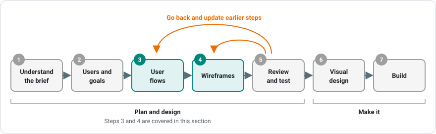

# Introduction

Many web apps run into trouble because they solve the wrong problem, confuse their users, or miss something the client needed. Planning and design is how you catch those problems **before** you write any code. This page explains why planning matters, what the design process looks like, and how the planning tools in this section fit together.

---

## Why Plan Before You Build?

It is tempting to open VS Code and start building straight away. On a small exercise that works. On a real project, it usually leads to rework, missed requirements and an app that is hard to use.

### Changes Get More Expensive Over Time

The later you find a problem, the more it costs to fix:

| When the problem is found | What it takes to fix |
|---|---|
| **While planning** | Edit a sentence in your notes or a box in a diagram |
| **While wireframing** | Move a few shapes in draw.io |
| **While coding** | Rewrite components, routes and styles |
| **After testing** | Rewrite code, then test everything again |
| **After launch** | All of the above, plus unhappy users and an unhappy client |

Imagine finding out in the final week that the client needed a waitlist for full classes. If that had shown up in a user flow, it would have taken five minutes to add a decision diamond. Finding it after the booking system is built can mean redesigning the database, the pages and the logic.

### Other Benefits of Planning

- **Everyone agrees on what is being built.** Clients often can't picture an app from a written description, but they can look at a user flow or a wireframe and say "that's right" or "that's not what I meant".
- **Requirements don't get lost.** Turning a brief into diagrams forces you to read every sentence and decide where each requirement goes.
- **The work can be shared out.** A team with a clear plan can split up screens and features without getting in each other's way.
- **Estimates are more accurate.** Once you know every screen and state, you can say how long the build will really take.
- **Testing is easier.** The paths in your user flows become the test cases you check before handing the app over.

!!! note "Planning saves time"
    A few hours of planning often saves days of coding. Experienced developers tend to spend more time planning than beginners, because they know how much rework it prevents.

***

## What is Design?

When people hear "design", they often think of colours, fonts and pictures. That is **visual design**. In software, design also covers **how an app works**: what the user can do, how content is organised and what happens when something goes wrong.

| Type of design | Question it answers | Examples |
|---|---|---|
| **User experience (UX) design** | Is the app easy and satisfying to use? | User flows, wireframes, usability testing |
| **Interaction design** | What happens when the user does something? | Button behaviour, form validation, error messages |
| **Information architecture** | How is the content organised and found? | Sitemaps, navigation, page names |
| **Visual (UI) design** | How does it look? | Colours, typography, spacing, icons |

This section focuses on **UX** and **interaction design**: working out what the user needs to do and how the app will help them do it. Visual design comes later, once the structure is agreed.

***

## User-Centred Design

**User-centred design** means basing decisions on what **users** need. When choosing between two layouts or features, pick the one that helps the user most, even if the other is easier to build.

Keep asking:

- **Who** will use this app? Are there different types of users with different needs?
- **What** are they trying to get done?
- **Where** and **how** will they use it: on a phone in a queue, or at a desk with plenty of time?
- **What could go wrong** for them along the way?

Your users may not use the app the way you do. A climber booking a class on their phone in a car park has very different needs from a developer testing on a large monitor.

### Accessibility

Designing for users means designing for **all** users, including people who use screen readers, can't use a mouse, have low vision or are colour blind. Accessibility is much easier to plan in from the start than to add later. While planning, make sure that:

- every action can be done with a keyboard
- information is never shown by colour alone (a full class should have a "Full" label as well as a red card)
- buttons and links have clear labels that make sense on their own
- text is large enough and has enough contrast to read

***

## The Design Process

Design is a process with steps that build on each other. Each step produces something the next step uses.

| Step | What you do | What you produce |
|---|---|---|
| **1. Understand the brief** | Read the brief, ask the client questions, identify the users | A list of requirements |
| **2. Define users and goals** | Work out who uses the app and what each user wants to do | User stories |
| **3. Plan user flows** | Map the steps and decisions for each goal | [User flow diagrams](user-flow-diagrams.md) |
| **4. Wireframe** | Lay out every screen in the flows | [Wireframes](wireframing.md) |
| **5. Review and test** | Check the plan with the client and with real users | Feedback and a revised plan |
| **6. Visual design** | Add colours, fonts and images | High-fidelity mockups |
| **7. Build** | Turn the plan into code | A working app |

### Design is Iterative

You will often go back a step during the process. Wireframing might show a screen that is missing from your user flows, or a client review might change a requirement. This is normal. Going back to fix the plan is much quicker than fixing the finished app.

!!! tip "Show your work early"
    Show your flows and wireframes to the client (or a classmate) as soon as they are rough. Feedback on a sketch takes minutes to act on. Feedback on a finished app takes weeks.

***

## How This Section Fits Together

The resources and tasks in this section follow the design process:

1. **[User Flow Diagrams](user-flow-diagrams.md):** turn a brief into users, goals and the step-by-step paths through the app, including what happens when things go wrong.
2. **[Wireframing](wireframing.md):** turn each screen from your user flows into a layout, for both mobile and desktop, including loading, empty and error states.

The **Planning User Flows** and **Building Wireframes** tasks give you a client brief and walk you through both steps, with each one building on the last.

---

## Summary

- Planning catches problems early, when they are quick and cheap to fix
- Diagrams help the client and the team agree on what is being built, and stop requirements getting lost
- Design covers how an app works (UX, interaction, information architecture) and how it looks (visual design)
- User-centred design bases decisions on users' needs, including accessibility
- The design process moves from the brief, to users and goals, to user flows, to wireframes, then to visual design and building
- Design is iterative, so expect to go back and update earlier steps
