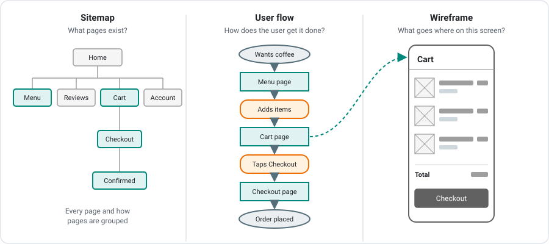
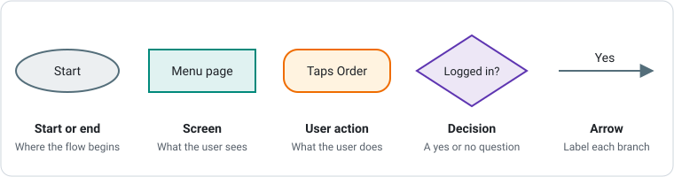
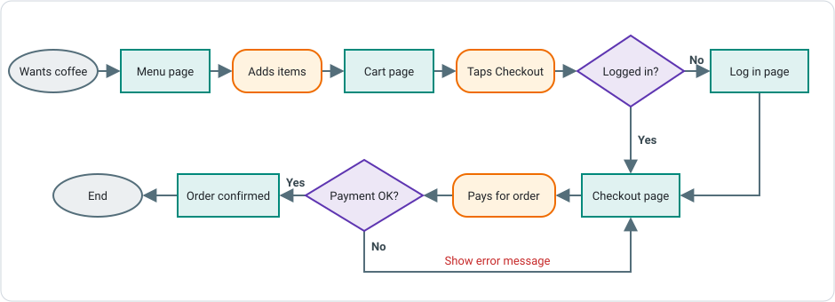

# User Flow Diagrams

A **user flow diagram** shows the steps a user takes through a website or app to complete one goal, such as ordering a coffee or booking a class. This page covers what user flows are, the symbols used to draw them, and how to turn a client brief into a flow you can build from.

---

## What is a User Flow?

Before writing any code, you need to know **what the user is trying to do** and **which screens they pass through to do it**. A user flow answers both questions in one diagram.

User flows sit alongside two other planning tools:

| | Sitemap | User flow | Wireframe |
|---|---|---|---|
| **Shows** | Every page and how pages are grouped | The path through screens to finish one task | The layout of one screen |
| **Answers** | What pages exist? | How does the user get this done? | What goes where on this screen? |
| **Covers** | The whole site | One user, one goal | One screen |



The diagram above shows how the three fit together for a cafe app. The pages highlighted in the sitemap are the ones the ordering flow passes through, and the wireframe shows the layout of one screen from that flow.

### Why Plan User Flows?

- **Find missing screens early.** Drawing the path often shows a screen nobody thought of, such as a "check your email" page after sign-up.
- **Plan for things going wrong.** Flows force you to decide what happens when a user is logged out, a form is invalid, or a payment fails.
- **Agree with the client.** A flow is easy for a non-technical client to read and approve.
- **Plan the code.** Each screen becomes a route, and each decision becomes an `if` statement or a piece of conditional rendering.
- **Test the finished app.** Every path through the flow is a test case.

***

## Users and Goals

Every flow starts with **who** the user is and **what they want to achieve**.

### Identify the Users

Read the client brief and list every type of person who will use the app. Different users often have different goals, different permissions and different screens. For a cafe ordering app, the users might be:

| User | Description |
|---|---|
| **Guest** | Someone browsing the menu who does not have an account |
| **Customer** | A logged-in user who places orders |
| **Staff member** | Cafe staff who see incoming orders and mark them as ready |

### Write the Goals as User Stories

A **user story** is a one-sentence goal written from the user's point of view:

```text
As a <type of user>, I want to <goal> so that <reason>.
```

For example:

```text
As a customer, I want to order a coffee for pickup so that I don't have to wait in the queue.
As a staff member, I want to see new orders as they arrive so that I can start making them.
```

**Draw one user flow for each goal.** Trying to fit several goals into one diagram makes it hard to read and easy to miss steps.

### Entry Points

The **entry point** is where the user starts. It is not always the home page. A user might arrive from a Google search result, a link in an email, a QR code on a table, or a bookmark. The entry point decides the first screen in the flow.

***

## User Flow Symbols

User flows use a small set of shapes. Each shape means something different, so a reader can tell at a glance whether a box is something the user **sees**, something the user **does**, or a **question** the app has to answer.



| Symbol | Meaning | How to label it | Example |
|---|---|---|---|
| **Oval** | Start or end of the flow | The trigger or the result | "Wants a coffee", "Order placed" |
| **Rectangle** | A screen or page | The real page name | "Cart page" |
| **Rounded rectangle** | Something the user does | A verb | "Taps Checkout", "Enters email" |
| **Diamond** | A decision with two or more outcomes | A yes or no question | "Logged in?" |
| **Arrow** | The direction of the flow | The answer, on arrows leaving a diamond | "Yes", "No" |

!!! note "Teams use different shapes"
    Not every team uses exactly these symbols. Some only draw screens and arrows, and some draw a tiny wireframe in each screen box (a **wireflow**). What matters is that you **use the same shapes consistently** and **include a legend** so anyone can read your diagram.

### System Actions

Sometimes the app does something by itself, without the user doing anything: sending an email, saving to a database, or moving someone off a waitlist. Show these as an action shape with a different colour or a **"System:"** prefix (for example "System: sends confirmation email"), and add it to your legend.

***

## The Happy Path and Alternate Paths

The **happy path** is the route where everything goes right: the user is logged in, every input is valid and nothing fails. Always draw the happy path first, as a straight line from start to end.

**Alternate paths** cover everything else. Real users are logged out, make typos, run out of stock and lose their internet connection. Walk through each step of the happy path and ask:

- What if the user is **not logged in**, or does not have an account yet?
- What if the user enters **invalid** or **missing** information?
- What if there is **nothing to show**, such as no search results or an empty cart?
- What if something **fails**, such as a payment, a network request or a sold-out item?
- What if the user **changes their mind** and goes back or cancels?
- Does the user's **type** change the path, such as a member versus a guest?

Each "what if" becomes a **decision diamond** with a labelled arrow for each answer.

!!! tip "Every path must go somewhere"
    Every arrow must lead either back into the flow (for example, back to the form with an error message) or to its own end point (for example, "Gives up"). A path that stops in the middle of nowhere is called a **dead end**, and it usually means a screen or message is missing.

***

## Example: Ordering Coffee for Pickup

The Daily Grind cafe wants customers to order online and collect their coffee from the counter. The goal for this flow is:

```text
As a customer, I want to order a coffee for pickup so that I don't have to wait in the queue.
```



Reading the diagram:

1. The flow **starts** with the customer wanting a coffee. The entry point is the **Menu page**.
2. The customer **adds items** and goes to the **Cart page**, then **taps Checkout**.
3. The app checks a **decision**: is the customer logged in? If **no**, the customer is sent to the **Log in page** first, then on to Checkout. If **yes**, they go straight to the **Checkout page**.
4. The customer **pays**. The app checks whether the payment worked.
5. If **no**, the flow loops back to the Checkout page and **shows an error message**, so the customer can try again.
6. If **yes**, the customer sees the **Order confirmed** page and the flow **ends**.

Notice that the diagram does not show what the pages look like. Layout belongs in a [wireframe](wireframing.md). The flow is only about the **order of steps** and the **decisions** along the way.

***

## Creating a User Flow

1. **Pick one user and one goal.** Write the goal as a user story and put it at the top of the diagram as a title.
2. **Choose the entry point and the end point.** Where does the user start, and what does success look like?
3. **List the happy path** as a sequence of screens and actions, in order.
4. **Draw the happy path** left to right (or top to bottom) in a straight line.
5. **Walk each step and ask "what if?"** Add a decision diamond wherever the path can split.
6. **Connect every branch.** Each one must loop back into the flow or reach an end point.
7. **Add a legend** that explains your shapes and colours.
8. **Check against the brief.** Every requirement the client mentioned for this goal should appear somewhere in the flow.

### Drawing User Flows in draw.io

[draw.io](https://app.diagrams.net/){target="_blank"} (also called diagrams.net) is a free diagramming tool that runs in your web browser, with no account or install needed. It includes all of the flowchart shapes used in user flows, lets you keep several diagrams in one file using pages, and exports to images and PDFs. That makes it a great choice for planning user flows.

Other tools work too: **Figma / FigJam**, **Miro**, **Lucidchart**, **Whimsical**, or pen and paper for a first draft.

***

## Common Mistakes

| Mistake | Fix |
|---|---|
| Several goals squeezed into one diagram | One flow per goal, each on its own page |
| Arrows leaving a diamond with no labels | Label every arrow that leaves a decision |
| Dead ends | Every path loops back or reaches an end point |
| Only the happy path is drawn | Add the alternate paths from the "what if" questions |
| Vague labels such as "Page 2" or "Click" | Use real page names and specific verbs ("Taps Book class") |
| Drawing buttons and layouts inside the flow | Keep layout for the wireframes |
| No legend | Add a small key explaining each shape and colour |

***

## From User Flow to Code

Each part of a user flow becomes something in your app:

| In the flow | In your app |
|---|---|
| Each **screen** | A page or route, such as `/menu`, `/cart` or `/checkout` |
| Each **user action** | A button, link, form input or event handler |
| Each **decision** | An `if` statement, a ternary in JSX, form validation or a redirect |
| Each **alternate path** | An error message, an empty state, a loading state or a redirect to log in |
| Each **path from start to end** | A test case to check before you hand the app over |

The list of screens in your flows is also the list of [wireframes](wireframing.md) you need to draw next.

---

## Summary

- A user flow shows the steps one user takes through an app to complete one goal
- Start by identifying the users and writing their goals as user stories
- Use ovals for start and end, rectangles for screens, rounded rectangles for actions, diamonds for decisions and labelled arrows for direction
- Draw the happy path first, then add alternate paths by asking "what if?" at every step
- Every branch must loop back or reach an end point, with no dead ends
- Include a title, a legend and real page names
- Screens become routes, decisions become conditions, and every path is a test case
