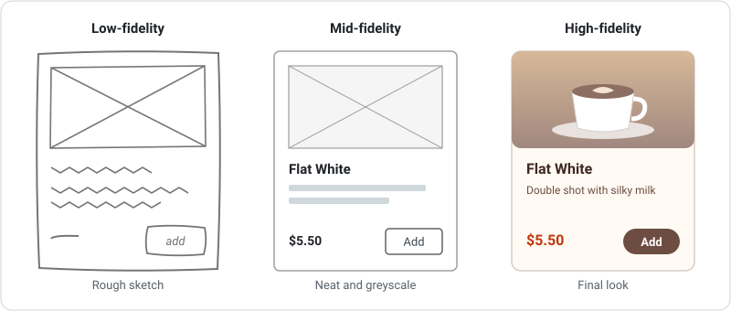
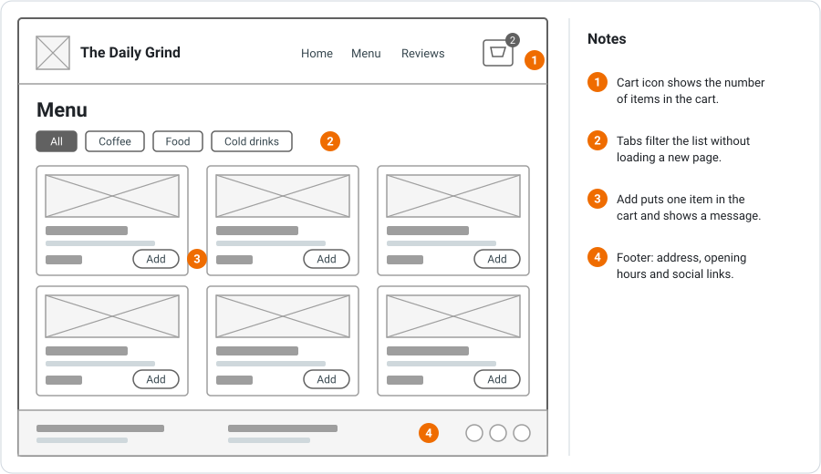
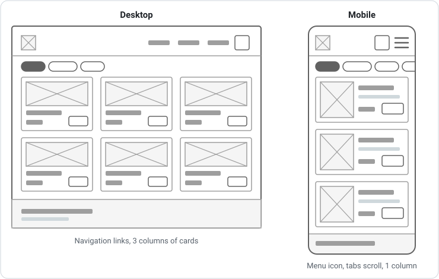
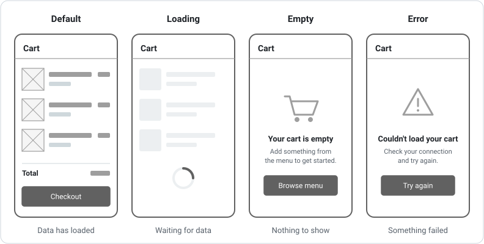
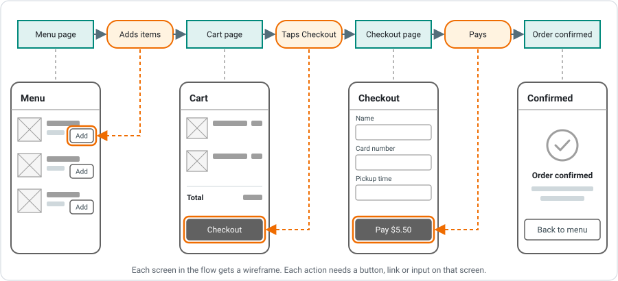

# Wireframing

A **wireframe** is a simple drawing of the layout of one screen. It shows what content and controls go on the screen and where they sit, without worrying about colours, fonts or real images. This page covers levels of fidelity, wireframe conventions, annotations, responsive layouts, screen states and how to turn a user flow into a set of wireframes.

---

## What is a Wireframe?

A wireframe is to a web app what a floor plan is to a house. It shows where the rooms go before anyone picks paint colours.

Wireframes are used to decide:

- **Structure:** which sections the screen has and in what order
- **Content:** what information the user needs on this screen
- **Hierarchy:** what is most important and should stand out
- **Function:** which buttons, links and inputs the user can use

Because wireframes are quick to draw and change, problems are cheap to fix. Moving a button in a wireframe takes seconds. Moving it after the page has been coded, styled and tested takes much longer.

***

## Levels of Fidelity

**Fidelity** means how close the drawing is to the finished product.

| Level | What it looks like | Purpose | Tools |
|---|---|---|---|
| **Low-fidelity** | Rough boxes and squiggles, often hand-drawn | Explore lots of layout ideas quickly | Pen and paper, whiteboard, Excalidraw |
| **Mid-fidelity** | Neat greyscale boxes, real labels and headings, consistent spacing | Agree on layout and content with the client and team | draw.io, Figma, Balsamiq |
| **High-fidelity mockup** | Real colours, fonts, images and branding | Final visual design for sign-off | Figma, Adobe XD |
| **Prototype** | Screens linked together so you can click through them | Test a user flow before building it | Figma, draw.io links |

In this course you will mostly create **mid-fidelity** wireframes: neat enough to build from, plain enough to change quickly.

***

## Wireframe Conventions

Wireframes use a shared visual language so anyone can read them.

| Element | How to draw it |
|---|---|
| **Image** | A box with an **X** through it |
| **Heading** | Real text, using the actual wording if you know it |
| **Body text** | Grey bars or lines, or placeholder text |
| **Button** | An outlined box with the **real label** ("Add", "Book class") |
| **Text input** | A box with a label above it and placeholder text inside |
| **Icon** | A small simple symbol (cart, hamburger menu, search) |
| **Navigation** | The real link names in a row, or a menu icon on mobile |
| **Repeated item** | A card or list row drawn the same way each time |

Rules to follow:

- **Greyscale only.** Colour distracts from layout decisions. The only exception is a single accent colour for annotations.
- **Real labels on anything clickable.** "Button" tells nobody anything. "Book class" tells the developer and the client exactly what happens.
- **Consistent sizes.** Every card, button and heading of the same type should be the same size.
- **Same header, navigation and footer on every screen.** If the navigation changes between screens, users get lost.

***

## Annotations

A wireframe shows what the user **sees**. **Annotations** explain what the user **can't see**: behaviour, rules and data.

Add a numbered marker on the wireframe and a matching numbered note beside it, as in the example above. Good things to annotate:

- **What happens on click.** "Opens the class detail page", "Shows a confirmation message"
- **Validation rules.** "Email must be valid", "Party size is 1 to 8"
- **Where data comes from.** "List of classes loaded from the API, sorted by start time"
- **Business rules from the brief.** "Cancel button hidden within 2 hours of the class start"
- **Who can see it.** "Only shown to logged-in staff"
- **States.** "Shows a spinner while loading" (see [Screen States](#screen-states))

!!! tip "Annotate the rules from the brief"
    Many client requirements are rules, such as "cancelling closes 2 hours before the class". To check your wireframes cover the brief, make sure every rule appears on a screen or in an annotation.

***

## Layout and Visual Hierarchy

**Visual hierarchy** is the order in which the eye notices things. Use it to make the most important thing on the screen the most obvious.

- **Size and position.** Bigger and higher means more important. Put the page heading and the main content near the top.
- **One primary action.** Each screen should have one main button (for example "Book class") that stands out, usually as a filled button. Secondary actions use outlined buttons or links.
- **Grouping.** Keep related things close together and separate unrelated groups with white space. A price belongs next to the item it is for, not in a column on the other side of the screen.
- **Alignment.** Line elements up on a **grid**. A common setup is 12 columns on desktop and 4 columns on mobile. Elements that share an edge look organised.
- **Scanning patterns.** Users scan text-heavy pages in an **F shape** (along the top, then down the left side) and simple pages in a **Z shape** (top left to top right, then diagonally down to bottom left, then across). Put key content where the eye goes.

***

## Responsive Wireframes

Your app will be used on phones, tablets and computers. The same content needs a different layout at each size.

Common changes from desktop to mobile:

| Desktop | Mobile |
|---|---|
| Navigation links in the header | A menu icon (hamburger) that opens the links |
| Several columns of cards | One column, stacked |
| Wide tables | Cards, or a table that scrolls sideways |
| Side panel (such as filters) | Filters move above the content or into a pop-up |
| Hover effects | Nothing can be hovered, so information must be visible or tappable |

**Mobile-first** design means wireframing the phone layout first. A small screen forces you to decide what really matters. Adding space for a desktop layout is easier than squeezing a desktop layout onto a phone.

Common frame widths to wireframe at:

| Device | Width |
|---|---|
| Mobile | `375px` |
| Tablet | `768px` |
| Desktop | `1280px` or `1440px` |

Buttons and links on mobile should be at least `44px` tall so they are easy to tap.

***

## Screen States

A screen does not always look the same. The same page can be in several **states**, and each one needs to be planned:

| State | When it happens | Example |
|---|---|---|
| **Default** | Data has loaded and there is something to show | A list of menu items |
| **Loading** | Data is being fetched | A spinner or grey placeholder cards |
| **Empty** | There is no data to show | "Your cart is empty" with a "Browse the menu" button |
| **Error** | Something went wrong | "We couldn't load the menu" with a "Try again" button |
| **Success** | An action has just worked | A message saying "Added to cart" |

Many states come straight from the **alternate paths** in your user flows. If your flow has a "Payment OK?" decision, the checkout screen needs an error state.

!!! tip "Empty states should help"
    An empty state should tell the user **why** there is nothing there and **what to do next**. "No bookings yet. Browse the timetable to book your first class." is far more useful than a blank screen.

You don't need to redraw a whole screen for a tiny change. If only one message appears, annotate it. Draw a separate state when the layout changes noticeably.

***

## From User Flow to Wireframes

If you have drawn [user flows](user-flow-diagrams.md), you already know which screens to wireframe.

1. **Make a screen inventory.** List every screen rectangle from all of your flows. Many screens appear in more than one flow, so only list each one once.
2. **Note who sees each screen and its route**, such as `/classes` or `/admin/classes/new`.
3. **Wireframe each screen**, naming each frame exactly as it appears in the flow.
4. **Check every action has a control.** Each rounded rectangle in the flow ("Taps Book", "Enters email") must appear on the wireframe as a visible button, link or input. If it doesn't, the user can't do it.
5. **Check every decision has a state.** Each diamond usually means a message, a redirect or a different version of a screen.
6. **Link the screens together** into a clickable prototype and click through each flow from start to end.

If you find a missing screen while wireframing, **update the user flow too**, so the two stay in sync.

***

## Wireframing in draw.io

draw.io includes a library of wireframe shapes.

1. Click **+ More Shapes** at the bottom of the shapes panel, enable **Mockups**, and click **Apply**. You now have libraries of buttons, inputs, containers, navigation and more.
2. Draw a **rectangle** the size of your device as the frame (for example `375 × 812` for mobile or `1280 × 800` for desktop). Set the size exactly in the **Arrange** tab of the Format panel.
3. Put **one screen per page** using the page tabs at the bottom, named after the screen. Use extra pages for states, such as "Timetable - Empty".
4. Build a component once (such as a class card), select its parts and press `Ctrl + G` to **group** it, then `Ctrl + D` to **duplicate** it.
5. To make a **clickable prototype**, right-click a button and choose **Edit Link**, then pick the page it should go to. In **View** mode (or after exporting to HTML), clicking the button jumps to that page.
6. Export with **File > Export as > PDF** and choose **All pages** to get one document containing every wireframe.

**Figma** is another popular choice. It has device frame presets, reusable **components** and a **Prototype** tab for linking screens together.

***

## Common Mistakes

| Mistake | Fix |
|---|---|
| Adding colours, fonts and photos | Stay greyscale until the layout is agreed |
| Labelling buttons "Button" | Use the real label, such as "Join waitlist" |
| Only drawing the desktop layout | Wireframe mobile first, then desktop |
| Only drawing the default state | Plan the loading, empty and error states too |
| A user flow action with no control on screen | Every action in the flow needs a visible button, link or input |
| Navigation changes from screen to screen | Keep the header, navigation and footer consistent |
| Rules from the brief are nowhere to be seen | Add them as annotations |

---

## Summary

- A wireframe shows the layout of one screen: structure, content, hierarchy and function
- Mid-fidelity wireframes are greyscale, use real labels and are neat enough to build from
- Images are boxes with an X, text is grey bars, and buttons show their real label
- Annotations explain behaviour, rules and data that can't be seen in the layout
- Use visual hierarchy and one obvious primary action per screen
- Wireframe mobile first, then adapt the layout for desktop
- Plan the loading, empty, error and success states for each screen
- Your user flows give you the list of screens to wireframe, and every action needs a control
