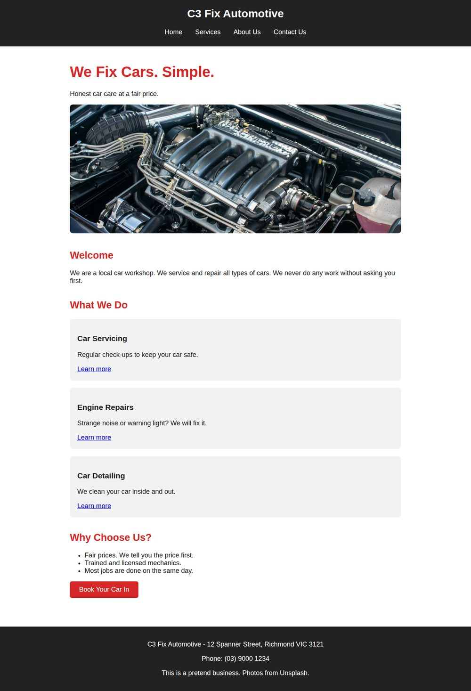
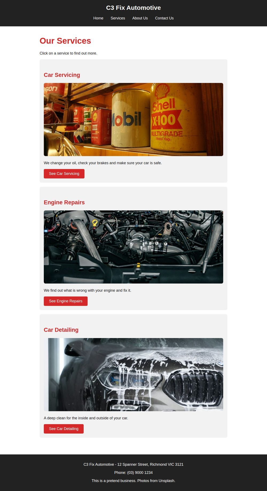
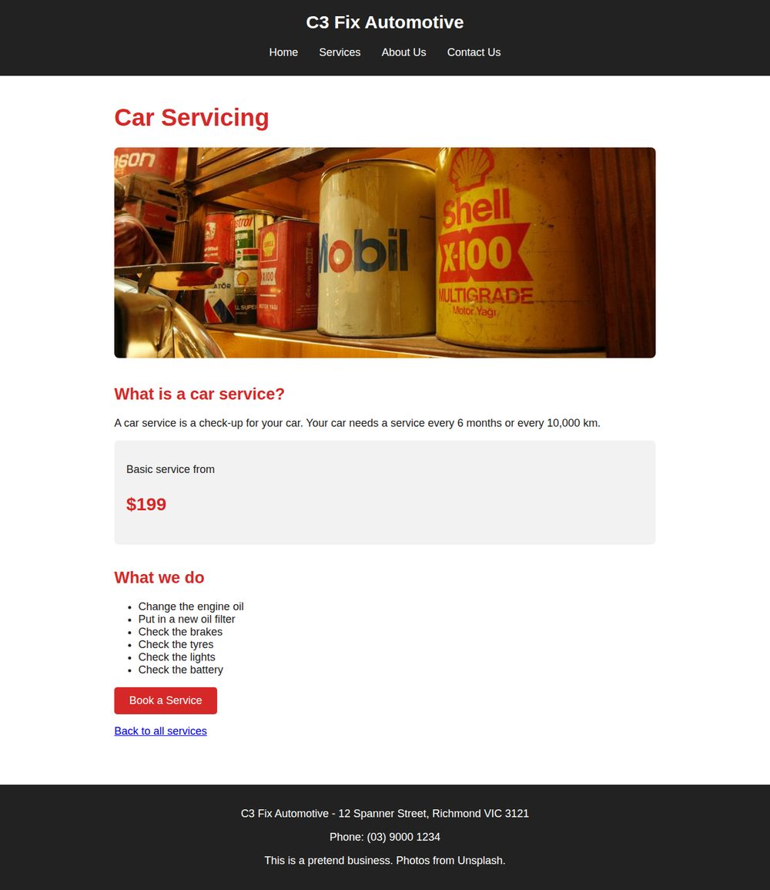
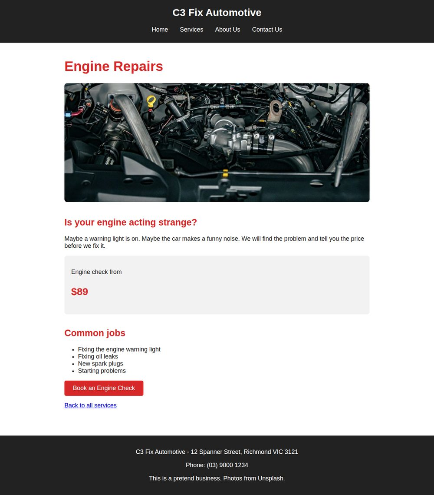
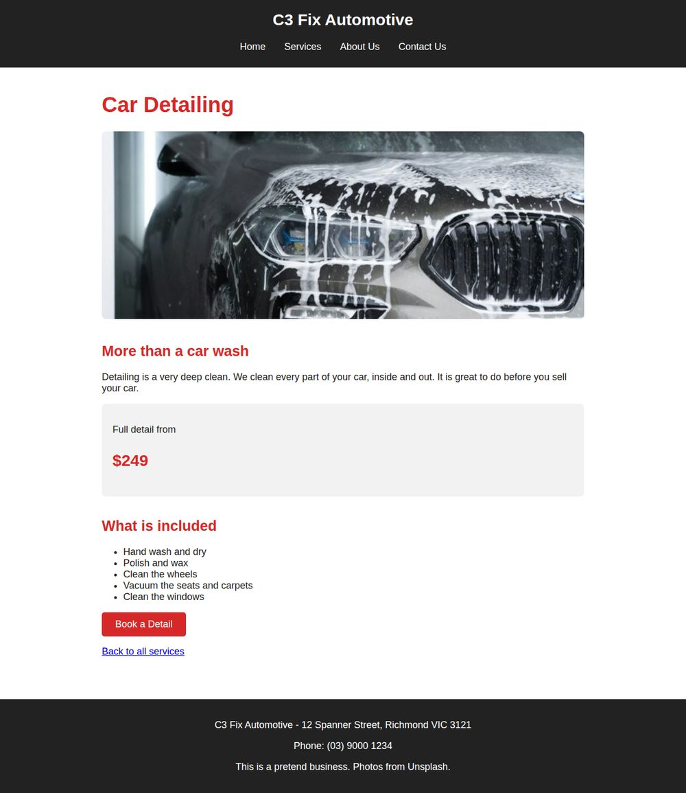
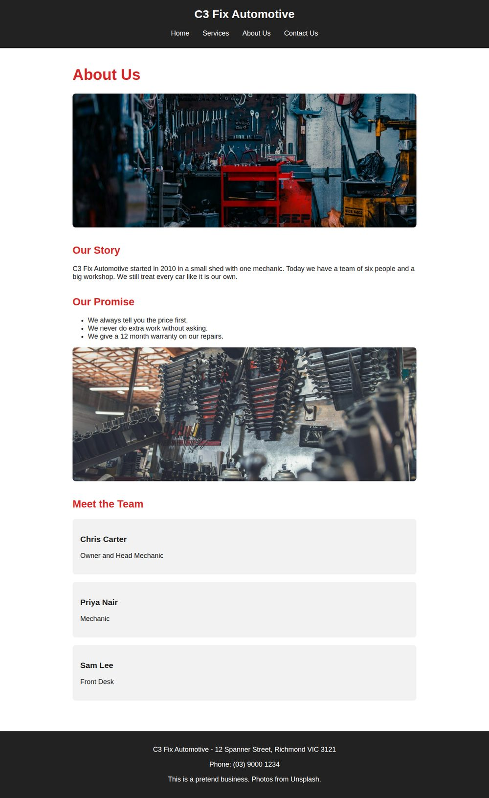
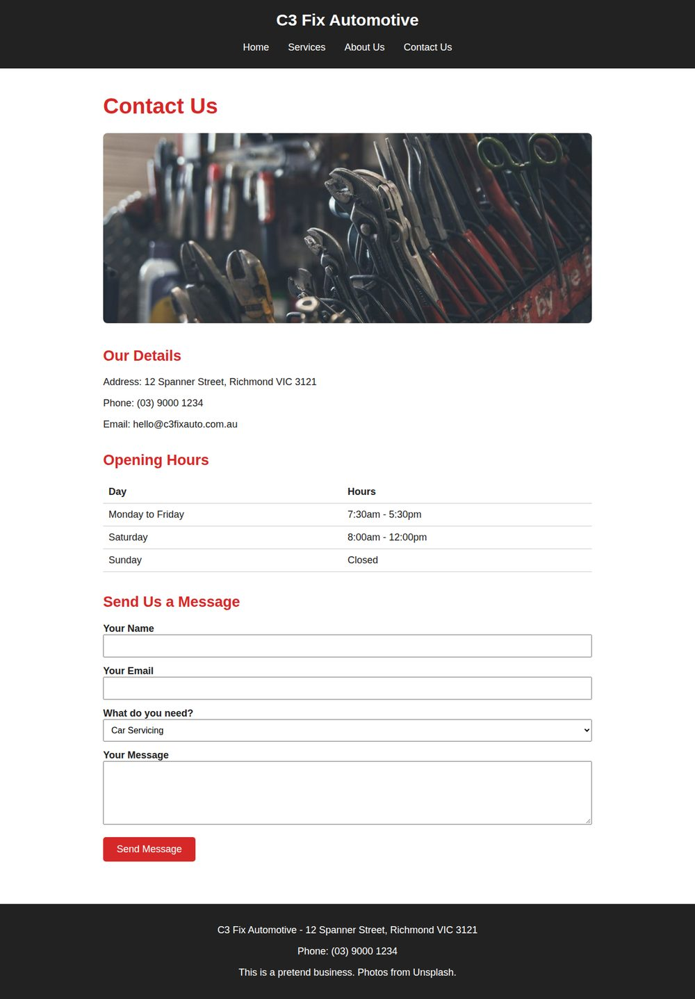

# Task 10 - Fix a Broken Website

!!! note "Working in VS Code"
    Every exercise in this task uses the **C3 Fix Automotive** website. Download it in the first exercise, then keep working on the same files until every page matches its picture.

## Download the Website

!!! abstract "Instructions"
    **Using VS Code**, download and open the C3 Fix Automotive website.

    - Download the zip file below and unzip it
    - Open the `c3-fix-automotive` folder in VS Code with `File` then `Open Folder...`
    - Open each page with **Live Preview** and compare it with its picture below

    The website has **17** mistakes.

    [Download Website](../../assets/task-10-c3-fix-automotive.zip){.md-button}

??? note "Home page - index.html"
    

??? note "Services page - services.html"
    

??? note "Car Servicing page - servicing.html"
    

??? note "Engine Repairs page - engine-repairs.html"
    

??? note "Car Detailing page - detailing.html"
    

??? note "About Us page - about.html"
    

??? note "Contact Us page - contact.html"
    

??? question "Hint"
    Right-click the zip file and choose **Extract All** before you open the folder. VS Code cannot open files that are still inside a zip file.

## Fix the Stylesheet Links

!!! abstract "Instructions"
    **Using VS Code**, find and fix the **two** pages that are not loading the stylesheet.

    When a page is fixed, it will have the dark header, red headings and grey boxes shown in its picture.

??? question "Hint"
    A page with no colours at all is a sign that the stylesheet is not loading. Look at the `link` element inside the `head`. Compare its `href` with the real name of the stylesheet and the folder it is in.

## Fix the Links Between Pages

!!! abstract "Instructions"
    **Using your web browser**, click every link and button on every page. Find and fix the **four** links that do not open the right page.

??? question "Hint"
    When a link is broken, the browser shows an error page instead of the website. Look at the `href` of that link and compare it with the file names in the folder, letter by letter. Check the spelling and the file extension.

## Fix the Images

!!! abstract "Instructions"
    **Using VS Code**, find and fix the **five** images that do not show.

??? question "Hint"
    A broken image often shows a small icon or its `alt` text instead of the picture. Look at the `img` element and check:

    - is the attribute name spelled correctly?
    - is the folder name right?
    - does the file name match a real file in the `images` folder?
    - is the file extension right?

## Fix the HTML Tags

!!! abstract "Instructions"
    **Using VS Code**, find and fix the **six** broken HTML tags.

    These mistakes can make text go missing, look the wrong size, or turn into code on the page.

??? question "Hint"
    If something looks wrong, look at the code just **above** that spot on the page. Ask yourself:

    - is every tag closed with a `>`?
    - does every closing tag have its `/`?
    - does every comment end with `-->`?
    - does every attribute value have two quote marks?

??? tip "Hint - Click to expand"
    VS Code colours your code to help you. If the colours suddenly look different from the code around it, there is often a mistake just before that point.

## Final Check

!!! abstract "Instructions"
    **Using your web browser**, check every page one last time.

    - every page matches its picture
    - every link and button opens the right page
    - every image shows

    Fixing one mistake can show you a new one that was hidden behind it. Keep checking until all **17** mistakes are fixed.

??? question "Hint"
    Count your fixes. If you have fixed fewer than 17, go back to the exercises above and check each page again.
