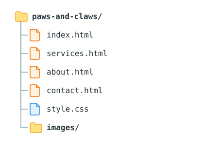

# Task 12 - Build a Website

In this task you will build the **Paws and Claws Pet Grooming** website from the client brief below, one step at a time. Then you will build the **Riverside Bike Repairs** website on your own, repeating the same process.

!!! quote "Client brief: Paws and Claws Pet Grooming"
    Hi, I run a small pet grooming salon called Paws and Claws and I'd like our first website. We need four pages: a home page, a services page, an about us page and a contact page.

    The home page should welcome visitors, tell them where we are and when we're open. Please put the opening hours in a table so they're easy to read, and add a link to the services page.

    The services page should list each of our grooming services with a photo, a short description and the price.

    On the about us page I'd like to tell the story of how the salon started and the year we opened, and introduce our groomers with a few words about each of them.

    The contact page needs a form where people can enter their name, email address and a message. It doesn't need to actually send yet, my nephew is going to set that part up later.

    Every page should have a menu so people can get to the other pages, and our logo at the top should take people back to the home page.

## Download the Images

!!! abstract "Instructions"
    **Using your web browser**, download the images for the Paws and Claws website and unzip them.

    [Download Paws and Claws Images](../../assets/task-12-paws-and-claws-images.zip){.md-button}

    The download contains:

    - `logo.svg`, the business logo
    - `wash-and-dry.jpg`, `haircut.jpg`, `brush-out.jpg` and `cat-grooming.jpg`, one photo for each grooming service

??? question "Hint"
    Right-click the zip file and choose **Extract All**. The photos come from Unsplash, which allows free reuse, and `credits.txt` lists where each one came from. The [Copyright and Images](../resources/legislation.md#copyright-and-images) section explains why you cannot use any image from a search engine.

## Set Up the Project

!!! abstract "Instructions"
    **Using VS Code**, create a project folder called `paws-and-claws` with this structure:

    

    Move the logo and photos from the download into your `images` folder, then open the project folder in VS Code.

??? question "Hint"
    Create the folder and open it in VS Code first, then create the files with the Explorer panel. Check every file name matches the diagram exactly, in lowercase.

## Build the Home Page Layout

!!! abstract "Instructions"
    **Using VS Code**, build the layout that every page will share in `index.html`. Use the template below as a starting point, and follow the comments.

    Your finished layout must include:

    - the full document structure with the title `Home | Paws and Claws`
    - a link to `style.css`
    - a `header` with your logo, wrapped in a link to the home page
    - a `nav` with links to all four pages, with the home link marked `active`
    - a `footer` with a copyright line using the copyright symbol

??? code "click to expand"
    ```html
    <!DOCTYPE html>
    <html lang="en">
    <head>
      <meta charset="UTF-8">
      <meta name="viewport" content="width=device-width, initial-scale=1.0">
      <!-- TODO: page title -->
      <!-- TODO: link to style.css -->
    </head>
    <body>

      <header>
        <!-- TODO: logo image, wrapped in a link to the home page -->
      </header>

      <nav>
        <!-- TODO: list of links to all four pages -->
      </nav>

      <main>
        <!-- Page content goes here -->
      </main>

      <footer>
        <!-- TODO: copyright line -->
      </footer>

    </body>
    </html>
    ```

??? question "Hint"
    The [Navigation Menus](../resources/links-navigation.md#navigation-menus) and [Image Links](../resources/links-navigation.md#image-links) sections of the Links and Navigation resource show how to build each part. The logo's `src` must include the `images` folder in its path.

## Create the Other Pages

!!! abstract "Instructions"
    **Using VS Code**, copy the layout from `index.html` into `services.html`, `about.html` and `contact.html`.

    On each page:

    - change the `title` to match the page
    - move the `active` class to the correct navigation link
    - leave the `header`, `nav` and `footer` otherwise identical

    Then click every navigation link and the logo on every page to check they all work.

??? question "Hint"
    With four pages, there are twenty links to test: four navigation links and one logo on each page. If a link fails, compare its `href` with the actual file name in the Explorer.

## Home Page Content

!!! abstract "Instructions"
    **Using VS Code**, add the home page content inside `main`. Make up suitable text for the business:

    - a main heading welcoming visitors, and a welcome paragraph
    - a `Find Us` section with the salon's address
    - an `Opening Hours` section with the hours in a table, using `thead` and `tbody`
    - a sentence containing a link to the services page

??? question "Hint"
    Put each part in its own `section` with an `h2` heading. The address element and line breaks keep the address on separate lines. The [Table Head and Body](../resources/tables-forms.md#table-head-and-body) section shows how to build the table.

## Services Page Content

!!! abstract "Instructions"
    **Using VS Code**, add the services page content inside `main`:

    - a main heading and a short introduction paragraph
    - a container for **each** service, containing its image, name, description and price
    - descriptive alt text on every image
    - the same class on every service container, and a class on every price

??? question "Hint"
    Build one service container completely, check it in Live Preview, then copy it for each other service and change the details. The [Grouping with Containers](../resources/nested-elements.md#grouping-with-containers) and [Identifying Elements with class and id](../resources/element-attributes.md#identifying-elements-with-class-and-id) sections show how.

## About Us Page Content

!!! abstract "Instructions"
    **Using VS Code**, add the about us page content inside `main`:

    - a main heading
    - an `Our Story` section with at least two paragraphs, including the year the salon opened
    - a `Meet the Team` section with a container for each groomer, containing their name, job title and a short description

??? question "Hint"
    Build each groomer's container the same way as the service containers, with a heading for the name and paragraphs for the job title and description. Give every container the same class so they can be styled as a group.

## Contact Page Content

!!! abstract "Instructions"
    **Using VS Code**, add the contact page content inside `main`:

    - a main heading and a paragraph inviting visitors to get in touch
    - a form with labelled `Name`, `Email` and `Message` fields
    - the email field using the email input type, and the message field as a larger box
    - a submit button that says `Send Message`
    - the form set so it does not send anywhere yet

??? question "Hint"
    The [Labels](../resources/tables-forms.md#labels) and [Input Types](../resources/tables-forms.md#input-types) sections show how to build each field. Check every label is connected by clicking it in Live Preview.

## Style the Website

!!! abstract "Instructions"
    **Using VS Code**, style the whole site in `style.css`:

    - store the site's colours in CSS variables
    - style the header, navigation bar (with hover, focus and active styles) and footer
    - centre the `main` area with a maximum width
    - style the opening hours table
    - lay out the services and team members as grids of cards
    - style the contact form

    Every page must use the same colours, fonts and layout.

??? question "Hint"
    The [Styling with CSS](../resources/css.md) resource covers each of these, in the [CSS Variables](../resources/css.md#css-variables), [Hover and Focus](../resources/css.md#hover-and-focus), [Grid](../resources/css.md#grid) and [Styling Tables and Forms](../resources/css.md#styling-tables-and-forms) sections. Keep related rules together in the stylesheet with a comment above each group, for example `/* Navigation */`, so you can find them later.

## Check Against the Requirements

!!! abstract "Instructions"
    **Using the client brief at the top of this task**, check the finished website against the brief, one sentence at a time.

    Fix anything the website is missing, then check again.

??? question "Hint"
    Open the site in Live Preview and look at each page as you go, rather than relying on memory. If a requirement says "every page", check it on all four pages.

## Build a Second Website

!!! abstract "Instructions"
    **Using VS Code**, build the **Riverside Bike Repairs** website from the client brief below, on your own.

    !!! quote "Client brief: Riverside Bike Repairs"
        We're a bike repair workshop and we need a simple website. We want a home page, a page listing our repair services, a page selling bike accessories, and a page with our contact details.

        On the home page we want a short introduction, our address and phone number, and our opening hours shown in a table. There should also be a link from the home page to the repairs page.

        The repairs page should have a table of repairs with the price of each one. The accessories page should show each product with a photo, name and price.

        The contact page should have our address and a form with fields for a name, a phone number, an email address, the type of bike and a message.

        Please use our logo on every page and have it link back to the home page, and make sure all the pages have the same menu.

    [Download Riverside Bike Repairs Images](../../assets/task-12-riverside-bike-repairs-images.zip){.md-button}

    Repeat the same process as the Paws and Claws website:

    - download and unzip the images
    - set up the project folder
    - build the shared layout, then create the other pages
    - add the content for each page
    - style the site with a single stylesheet
    - check the site against every sentence of the brief

??? question "Hint"
    Follow the steps of this task in the same order. This brief includes a repairs **table** and extra form fields that the Paws and Claws site did not have, so read the brief carefully. For the phone number field, look at the input types in the [Tables and Forms](../resources/tables-forms.md#input-types) resource.
