# Mantine UI

Mantine is a fully-featured React component library that gives you production-ready building blocks for your interface. It ships as an npm package with hooks, form handling, notifications, and much more.

---

## What is Mantine?

Mantine provides over 100 components and hooks built with accessibility and developer experience in mind. Key characteristics:

- **Drop-in components** — install the package and use components immediately
- **Themeable** — customise colours, spacing, typography, and more through `MantineProvider`
- **Accessible** — components follow WAI-ARIA standards out of the box
- **All-in-one** — includes hooks, form management, modals, notifications, and rich text editing

---

## Setting Up Mantine

Install the core package and hooks:

```bash
npm install @mantine/core @mantine/hooks
```

Additional optional packages:

```bash
npm install @mantine/form @mantine/notifications @mantine/modals
npm install @mantine/charts recharts
```

Wrap your app with `MantineProvider`:

```tsx
// app/layout.tsx
import "@mantine/core/styles.css";
import { MantineProvider } from "@mantine/core";

export default function RootLayout({ children }: { children: React.ReactNode }) {
    return (
        <html lang="en">
            <body>
                <MantineProvider>
                    {children}
                </MantineProvider>
            </body>
        </html>
    );
}
```

!!! note
    Always import `@mantine/core/styles.css` to apply the default styling.

---

## Using Components

Import and use components directly:

```tsx
import { Button } from "@mantine/core";

export default function Page() {
    return (
        <div>
            <Button variant="filled">Save</Button>
            <Button variant="outline">Cancel</Button>
            <Button color="red">Delete</Button>
        </div>
    );
}
```

---

## Available Component Types

Mantine includes components for most UI needs. The sections below show what each one looks like and the props you will use most.

| Category | Components |
|---|---|
| Actions | Button, ActionIcon, Menu |
| Forms | TextInput, Textarea, NumberInput, PasswordInput, Select, Checkbox, Radio, Switch, SegmentedControl |
| Data Display | Card, Badge, Avatar, Table, Accordion, Timeline |
| Layout | Container, Stack, Group, SimpleGrid, AppShell |
| Navigation | Tabs, NavLink, Breadcrumbs, Pagination, Stepper |
| Feedback | Alert, Notification, Tooltip, Loader, Skeleton, LoadingOverlay |
| Overlays | Modal, Drawer |
| Charts | BarChart, DonutChart, LineChart |

Every component has its own page on [mantine.dev](https://mantine.dev) with a full list of props and live examples.

---

## Actions

### Button and ActionIcon

`Button` is the main way to trigger an action. The `variant` prop sets its style and `color` sets its colour. Use one variant for the main action on a screen (usually `filled`) and a quieter one (`outline`, `light`, `subtle` or `default`) for everything else.

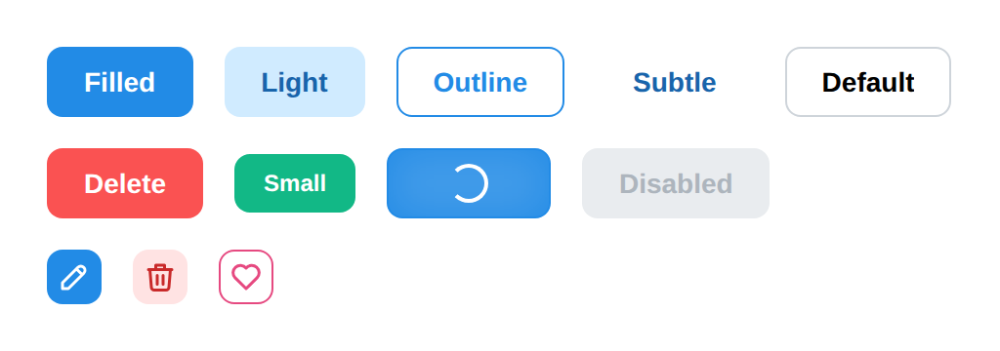

```tsx
<Button variant="filled">Save</Button>
<Button variant="outline">Cancel</Button>
<Button color="red">Delete</Button>
<Button loading>Saving</Button>
<Button disabled>Disabled</Button>
```

`loading` shows a spinner and stops the button being clicked again, which is useful while a form is saving. `ActionIcon` is a square button for a single icon. Because it has no text, always give it an `aria-label` so screen readers can announce it:

```tsx
<ActionIcon variant="light" color="red" aria-label="Delete">
    <TrashIcon />
</ActionIcon>
```

***

### Menu

A `Menu` opens a dropdown list of actions from a button. It suits rows in a table or cards that have several actions, so the screen does not fill up with buttons.

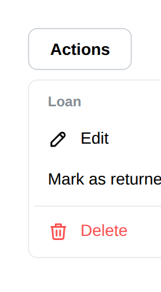

```tsx
<Menu>
    <Menu.Target>
        <Button variant="default">Actions</Button>
    </Menu.Target>
    <Menu.Dropdown>
        <Menu.Label>Loan</Menu.Label>
        <Menu.Item>Edit</Menu.Item>
        <Menu.Item>Mark as returned</Menu.Item>
        <Menu.Divider />
        <Menu.Item color="red">Delete</Menu.Item>
    </Menu.Dropdown>
</Menu>
```

`Menu.Target` holds the element that opens the menu. Each `Menu.Item` takes an `onClick` like a button.

---

## Form Inputs

### Text Inputs

Mantine's text inputs build the `<label>`, the input and any error message for you, and link them together so clicking the label focuses the input.

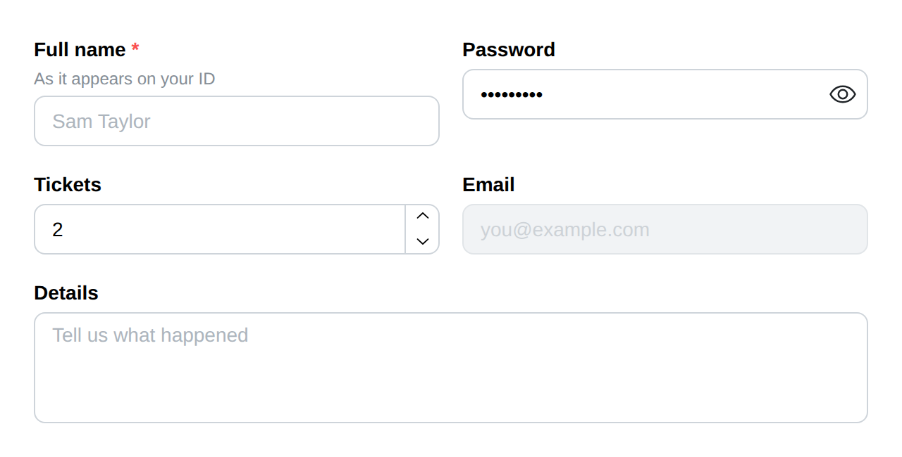

| Component | Use it for |
|---|---|
| `TextInput` | A single line of text, such as a name or email |
| `Textarea` | Longer text. Add `autosize` with `minRows` and `maxRows` to let it grow |
| `NumberInput` | Numbers, with `min`, `max` and up/down controls |
| `PasswordInput` | Passwords, with a button to show or hide the text |

```tsx
<TextInput
    label="Full name"
    description="As it appears on your ID"
    placeholder="Sam Taylor"
    withAsterisk
    value={name}
    onChange={(event) => setName(event.currentTarget.value)}
/>
```

`label`, `description`, `placeholder`, `withAsterisk`, `disabled` and `error` work the same way on every Mantine input. `TextInput`, `Textarea` and `PasswordInput` pass a normal change event to `onChange`. `NumberInput` passes the number itself, or an empty string when the input is cleared.

***

### Select

A `Select` is a dropdown where the user picks one option from a list. Pass the options as an array in `data`.

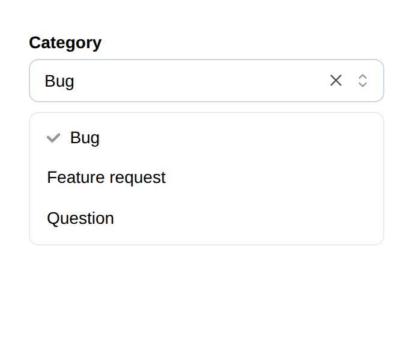

```tsx
<Select
    label="Category"
    placeholder="Pick one"
    data={["Bug", "Feature request", "Question"]}
    clearable
    value={category}
    onChange={setCategory}
/>
```

Unlike a text input, `onChange` gives you the chosen **string**, not an event. When the user clears the select, the value is `null`, so its state type is `string | null`. Add `searchable` to let the user type to filter a long list. If you need several choices at once, use `MultiSelect` instead.

***

### Checkbox, Radio and Switch

These controls are for yes/no answers and small sets of options.

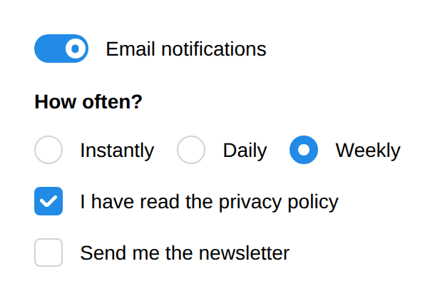

| Component | Use it for |
|---|---|
| `Switch` | A setting that turns on or off straight away |
| `Checkbox` | Agreeing to something, or ticking several items from a list |
| `Radio.Group` with `Radio` | Choosing exactly one option from a short list that is always visible |

```tsx
<Switch
    label="Email notifications"
    checked={emailOn}
    onChange={(event) => setEmailOn(event.currentTarget.checked)}
/>

<Radio.Group label="How often?" value={frequency} onChange={setFrequency}>
    <Group mt="xs">
        <Radio value="instant" label="Instantly" />
        <Radio value="daily" label="Daily" />
        <Radio value="weekly" label="Weekly" />
    </Group>
</Radio.Group>
```

`Switch` and `Checkbox` use `checked` instead of `value`, and you read `event.currentTarget.checked`. `Radio.Group` works like `Select`: its `onChange` gives you the chosen value as a string. `Checkbox.Group` does the same for several checkboxes, storing the ticked values in a `string[]`.

***

### SegmentedControl

A `SegmentedControl` is a row of buttons where exactly one is selected. It suits small settings like a view mode or a filter, where all the options fit on one line.

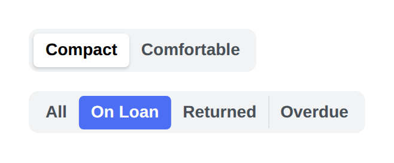

```tsx
<SegmentedControl
    data={["All", "On Loan", "Returned", "Overdue"]}
    value={filter}
    onChange={setFilter}
/>
```

To show different text from the stored value, pass objects instead: `{ label: "Compact", value: "compact" }`. The arrow keys move between segments.

***

### Showing Errors

Every input takes an `error` prop. When it has text, the input turns red and the message appears directly under it. The `@mantine/form` package's `useForm` hook sets these errors for you from your validation rules.

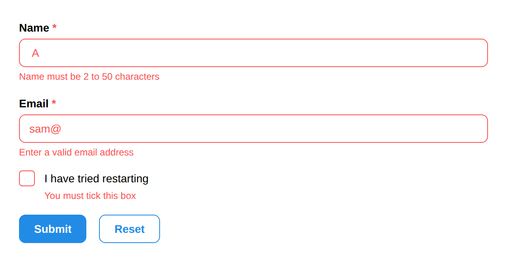

```tsx
<TextInput label="Email" withAsterisk error="Enter a valid email address" />
```

Mantine links the error message to the input with `aria-describedby`, so screen readers read the error when the input is focused.

---

## Data Display

### Card

A `Card` groups related content in a box. Add `withBorder` for an outline, `shadow` to lift it off the page, and `padding` and `radius` for spacing and rounded corners.

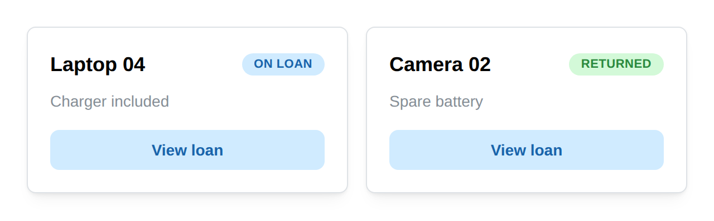

```tsx
<Card shadow="sm" padding="lg" radius="md" withBorder>
    <Group justify="space-between" mb="xs">
        <Title order={4}>Laptop 04</Title>
        <Badge color="blue" variant="light">On Loan</Badge>
    </Group>
    <Text size="sm" c="dimmed">Charger included</Text>
    <Button variant="light" fullWidth mt="md">View loan</Button>
</Card>
```

Cards work well for items that each have a picture or several actions. Put several in a `SimpleGrid` to make a responsive grid.

***

### Badge

A `Badge` is a small label for a status, a category or a count.

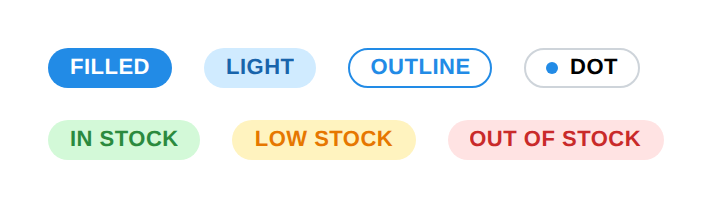

```tsx
<Badge color="green" variant="light">In Stock</Badge>
<Badge color="yellow" variant="light">Low Stock</Badge>
<Badge color="red" variant="light">Out of Stock</Badge>
```

Always put the status as text inside the badge. Some people cannot tell red from green, so the colour should back up the words, not replace them.

***

### Avatar

An `Avatar` shows a user's picture, or their initials when there is no picture. `Avatar.Group` overlaps several avatars.

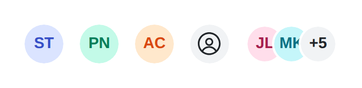

```tsx
<Avatar src={user.photoUrl} alt={user.name} radius="xl" />
<Avatar color="indigo" radius="xl">ST</Avatar>
```

***

### Table

Mantine's `Table` creates a real HTML table with Mantine's styling. You build it from `Table.Thead`, `Table.Tbody`, `Table.Tr`, `Table.Th` and `Table.Td`, which become `<thead>`, `<tbody>`, `<tr>`, `<th>` and `<td>`.

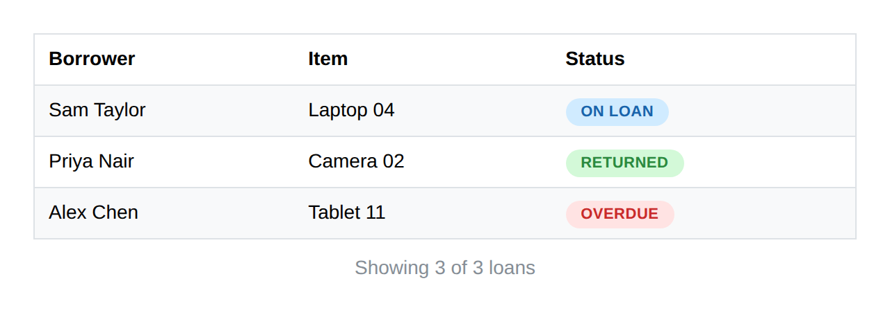

```tsx
<Table striped highlightOnHover withTableBorder>
    <Table.Thead>
        <Table.Tr>
            <Table.Th>Borrower</Table.Th>
            <Table.Th>Item</Table.Th>
        </Table.Tr>
    </Table.Thead>
    <Table.Tbody>
        {loans.map((loan) => (
            <Table.Tr key={loan.id}>
                <Table.Td>{loan.borrower}</Table.Td>
                <Table.Td>{loan.item}</Table.Td>
            </Table.Tr>
        ))}
    </Table.Tbody>
    <Table.Caption>Showing {loans.length} loans</Table.Caption>
</Table>
```

`striped` shades every second row, `highlightOnHover` shades the row under the mouse, and `verticalSpacing` sets the row height. Wrap a wide table in `Table.ScrollContainer` with a `minWidth` so it scrolls sideways on small screens instead of squashing.

Use a table when people need to compare the same details across many rows. Use cards when each item is better read on its own.

***

### Accordion

An `Accordion` is a list of headings that open to show more content. It is good for FAQs and long settings pages, because the user only opens the parts they need.

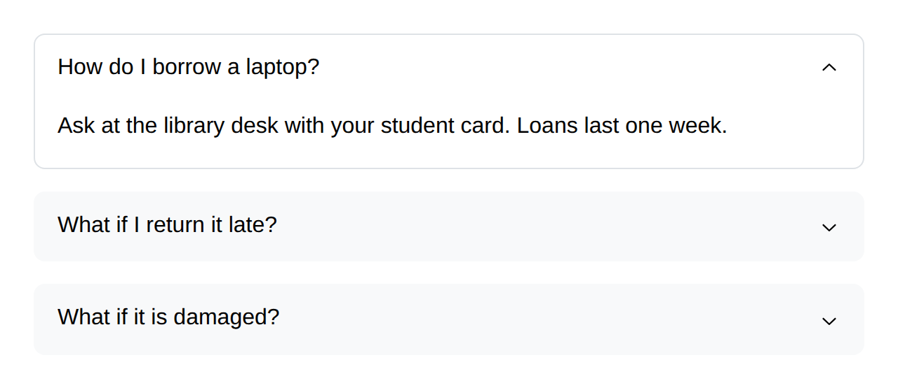

```tsx
<Accordion variant="separated" defaultValue="borrow">
    <Accordion.Item value="borrow">
        <Accordion.Control>How do I borrow a laptop?</Accordion.Control>
        <Accordion.Panel>Ask at the library desk with your student card.</Accordion.Panel>
    </Accordion.Item>
</Accordion>
```

Each `Accordion.Item` needs a unique `value`. `defaultValue` chooses which item starts open.

***

### Timeline

A `Timeline` shows events in order, such as the history of an order or a loan. `active` sets how many steps are complete.

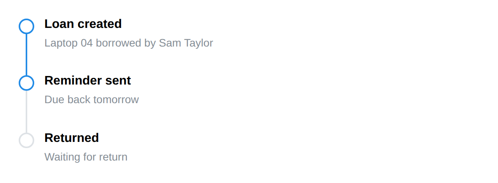

```tsx
<Timeline active={1}>
    <Timeline.Item title="Loan created">Laptop 04 borrowed by Sam Taylor</Timeline.Item>
    <Timeline.Item title="Reminder sent">Due back tomorrow</Timeline.Item>
    <Timeline.Item title="Returned">Waiting for return</Timeline.Item>
</Timeline>
```

---

## Layout

### Stack, Group and SimpleGrid

These three components handle most page layout without any CSS.

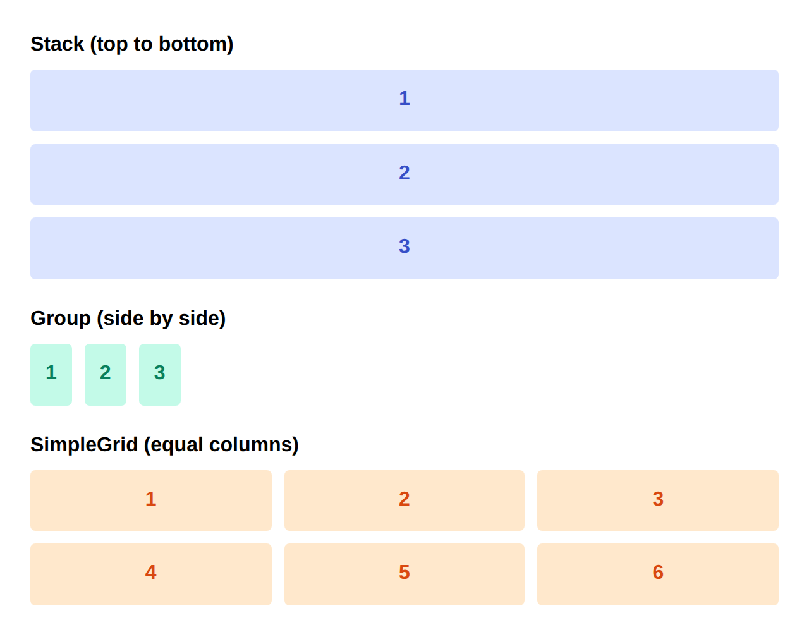

| Component | What it does |
|---|---|
| `Stack` | Places children top to bottom with a `gap` between them |
| `Group` | Places children side by side. `justify` spreads them out and `wrap` lets them flow onto a new line |
| `SimpleGrid` | Places children in equal columns. `cols` can change with screen size |

```tsx
<Stack gap="md">...</Stack>

<Group justify="space-between">...</Group>

<SimpleGrid cols={{ base: 1, sm: 2, lg: 3 }} spacing="md">...</SimpleGrid>
```

Spacing props such as `gap` and `spacing` take Mantine sizes: `"xs"`, `"sm"`, `"md"`, `"lg"` and `"xl"`. `Container` sets a maximum width and centres your page, for example `<Container size="sm" py="xl">`.

***

### AppShell

`AppShell` gives a whole app a fixed header, an optional side navigation bar and a main content area.

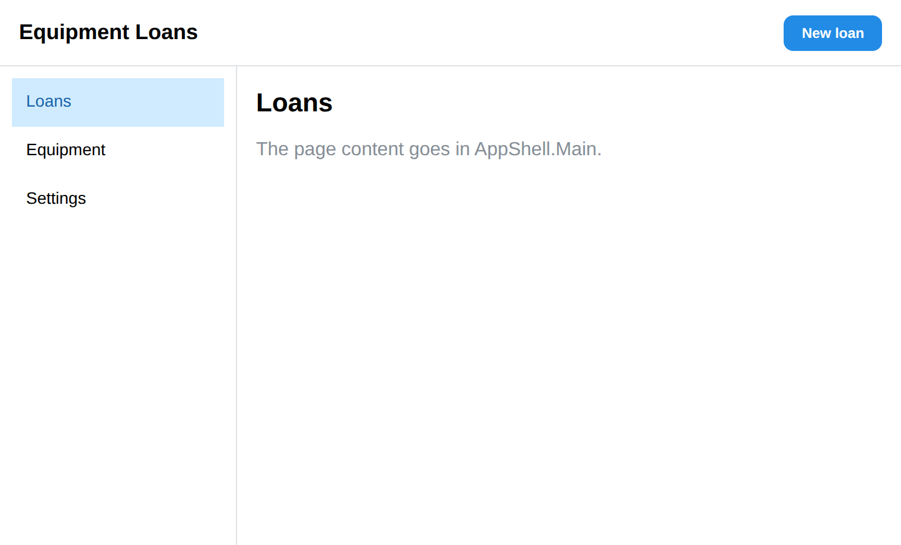

```tsx
<AppShell header={{ height: 60 }} navbar={{ width: 200, breakpoint: "sm" }} padding="md">
    <AppShell.Header>Equipment Loans</AppShell.Header>
    <AppShell.Navbar p="xs">{/* NavLinks */}</AppShell.Navbar>
    <AppShell.Main>{/* page content */}</AppShell.Main>
</AppShell>
```

On screens narrower than the `breakpoint`, the navbar takes up the full width of the screen. The [AppShell documentation](https://mantine.dev/core/app-shell/) shows how to hide it with `navbar.collapsed` and add a `Burger` button that opens and closes it on phones.

---

## Navigation

### Tabs

`Tabs` switch between several panels in the same spot on the page, such as a table view and a card view of the same data.

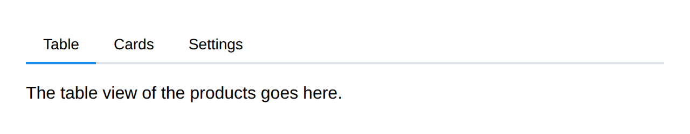

```tsx
<Tabs defaultValue="table">
    <Tabs.List>
        <Tabs.Tab value="table">Table</Tabs.Tab>
        <Tabs.Tab value="cards">Cards</Tabs.Tab>
    </Tabs.List>
    <Tabs.Panel value="table">{/* table view */}</Tabs.Panel>
    <Tabs.Panel value="cards">{/* card view */}</Tabs.Panel>
</Tabs>
```

Each `Tabs.Tab` opens the `Tabs.Panel` with the same `value`. The arrow keys move between tabs.

***

### NavLink

`NavLink` is a link for side navigation. `active` highlights the current page, and putting NavLinks inside another makes a section that opens and closes.

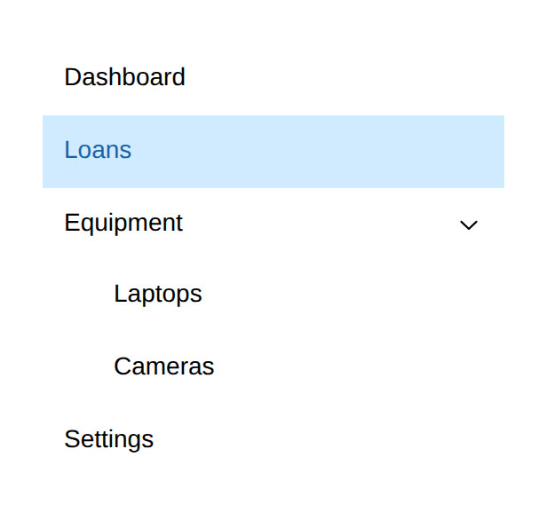

```tsx
<NavLink href="/loans" label="Loans" active />
<NavLink label="Equipment" defaultOpened>
    <NavLink href="/laptops" label="Laptops" />
    <NavLink href="/cameras" label="Cameras" />
</NavLink>
```

In Next.js, pass `component={Link}` (from `next/link`) so the link uses client-side navigation.

***

### Breadcrumbs and Pagination

`Breadcrumbs` show where the current page sits in the site. `Pagination` lets the user move through long lists one page at a time.

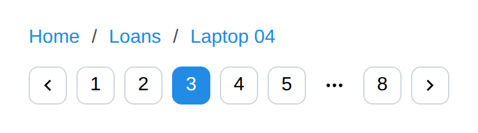

```tsx
<Breadcrumbs>
    <Anchor href="/">Home</Anchor>
    <Anchor href="/loans">Loans</Anchor>
    <Anchor href="/loans/4">Laptop 04</Anchor>
</Breadcrumbs>

<Pagination total={8} value={page} onChange={setPage} />
```

To show one page of results, slice your array with the page number: `items.slice((page - 1) * pageSize, page * pageSize)`.

***

### Stepper

A `Stepper` splits a long form into steps and shows how far through the user is. `active` is the index of the current step, starting at 0.

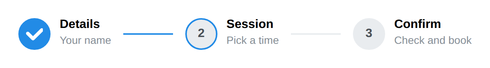

```tsx
<Stepper active={active} onStepClick={setActive}>
    <Stepper.Step label="Details" description="Your name">{/* step 1 fields */}</Stepper.Step>
    <Stepper.Step label="Session" description="Pick a time">{/* step 2 fields */}</Stepper.Step>
    <Stepper.Step label="Confirm" description="Check and book">{/* summary */}</Stepper.Step>
</Stepper>
```

---

## Feedback

### Alert

An `Alert` is a coloured box for a message that stays on the page, such as a load error or a success message after a form is sent.

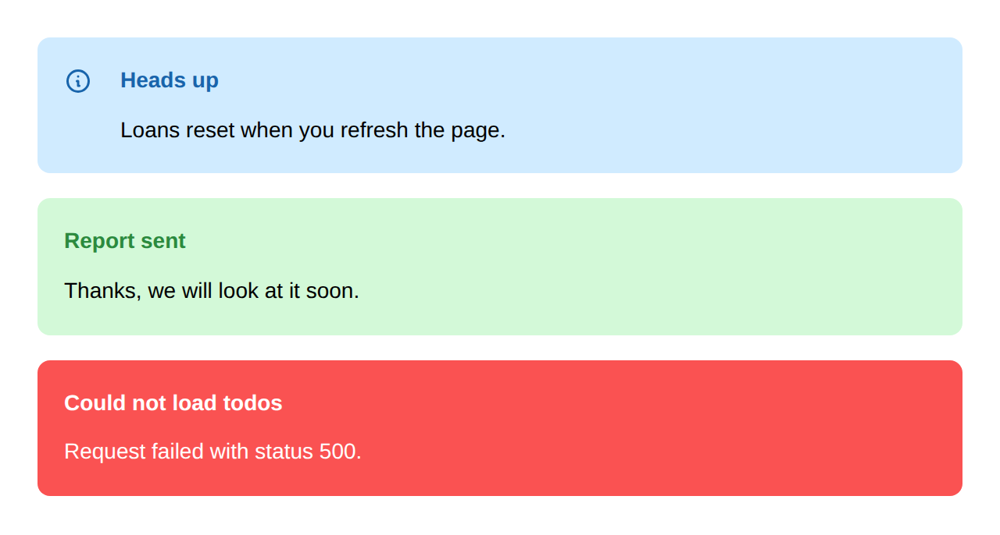

```tsx
<Alert color="red" title="Could not load todos">
    {error}
</Alert>
```

`variant` can be `light` (the default), `filled`, `outline` or `default`. Add `withCloseButton` and `onClose` if the user should be able to dismiss it.

***

### Notifications

Notifications pop up in the corner of the screen after an action, then close by themselves. They need the `@mantine/notifications` package, its stylesheet, and a `<Notifications />` component inside `MantineProvider` in your layout.

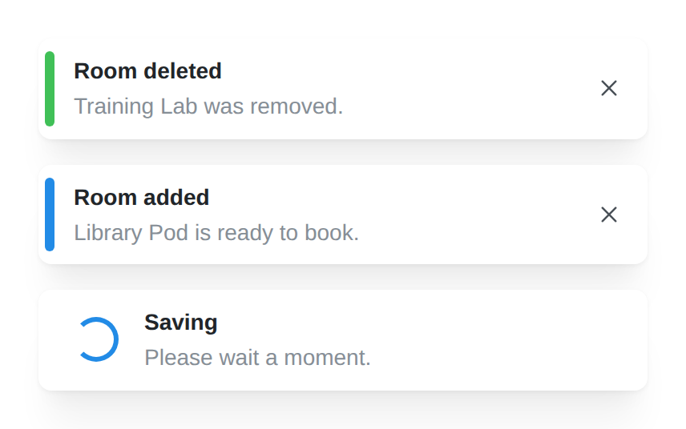

```bash
npm install @mantine/notifications
```

```tsx
// app/layout.tsx
import "@mantine/notifications/styles.css";
import { Notifications } from "@mantine/notifications";

<MantineProvider>
    <Notifications />
    {children}
</MantineProvider>
```

Then call `notifications.show()` from any client component:

```tsx
import { notifications } from "@mantine/notifications";

notifications.show({
    title: "Room deleted",
    message: "Training Lab was removed.",
    color: "green",
});
```

`autoClose: false` keeps a notification open until the user closes it, which suits errors. Give a notification an `id` if you need to update or hide it later with `notifications.update()` or `notifications.hide()`.

Use a notification for something that just happened. Use an `Alert` for something the user still needs to see after the notification would have gone.

***

### Tooltip

A `Tooltip` shows a short label when the user hovers over or focuses an element. It is most useful on icon-only buttons.

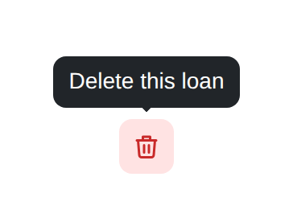

```tsx
<Tooltip label="Delete this loan" withArrow>
    <ActionIcon variant="light" color="red" aria-label="Delete this loan">
        <TrashIcon />
    </ActionIcon>
</Tooltip>
```

Touch screens have no hover, so tooltips are easy to miss on phones. Never put information only in a tooltip.

***

### Loader and Skeleton

Show a `Loader` or `Skeleton` while data is loading so the page does not look broken.

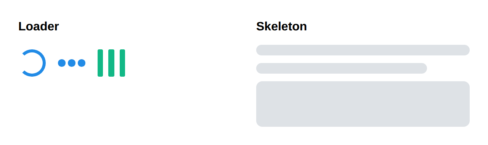

```tsx
<Loader />
<Loader type="dots" />

<Skeleton height={14} radius="xl" />
<Skeleton height={60} />
```

A `Loader` is a spinner. A `Skeleton` is a grey placeholder shaped like the content that is coming, which stops the page jumping around when the data arrives. Use skeletons for lists and cards, and a loader for small areas or buttons.

***

### LoadingOverlay

A `LoadingOverlay` covers a section with a spinner and blocks clicks while something is saving. Its parent must have `pos="relative"` so the overlay covers only that section.

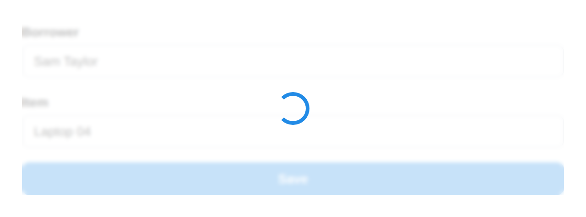

```tsx
<Box pos="relative">
    <LoadingOverlay visible={saving} overlayProps={{ blur: 2 }} />
    {/* form */}
</Box>
```

---

## Overlays

### Modal

A `Modal` is a dialog that opens on top of the page. Use one to ask "are you sure?" before deleting, or to show a short form without leaving the page.

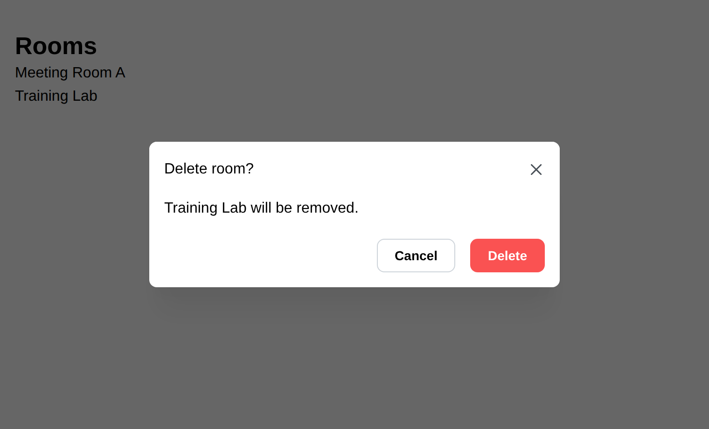

```tsx
const [opened, { open, close }] = useDisclosure(false);

<Button color="red" onClick={open}>Delete</Button>

<Modal opened={opened} onClose={close} title="Delete room?" centered>
    <Text mb="lg">Training Lab will be removed.</Text>
    <Group justify="flex-end">
        <Button variant="default" onClick={close}>Cancel</Button>
        <Button color="red" onClick={handleDelete}>Delete</Button>
    </Group>
</Modal>
```

`useDisclosure` from `@mantine/hooks` gives you an `opened` boolean with `open` and `close` functions. Mantine handles the keyboard for you: focus moves into the modal, **Tab** stays inside it, **Escape** closes it, and focus returns to the button that opened it.

***

### Drawer

A `Drawer` works like a modal but slides in from the side of the screen. It suits settings panels and filters.

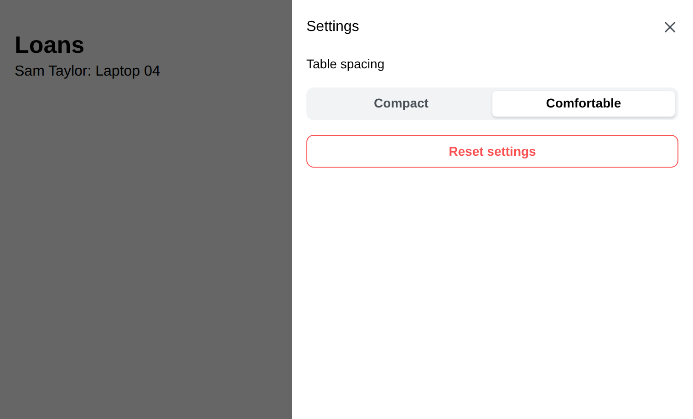

```tsx
<Drawer opened={opened} onClose={close} title="Settings" position="right">
    {/* settings */}
</Drawer>
```

`position` can be `left`, `right`, `top` or `bottom`.

---

## Charts

The `@mantine/charts` package draws charts with the same colours and fonts as the rest of Mantine. It is built on a library called Recharts, so you install both and import the charts stylesheet in your layout:

```bash
npm install @mantine/charts recharts
```

```tsx
// app/layout.tsx
import "@mantine/charts/styles.css";
```

Every chart needs `"use client";` because it draws in the browser.

***

### BarChart

A `BarChart` compares amounts between groups, such as sales per day or loans per status.

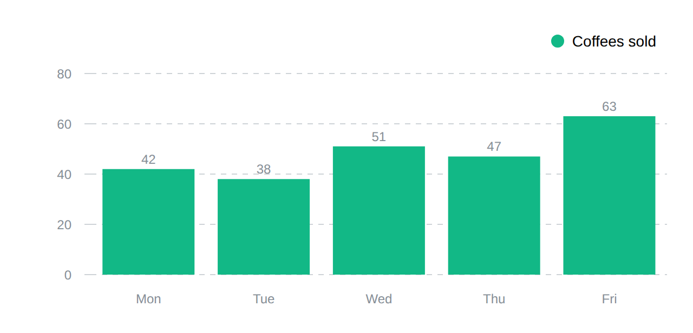

```tsx
const sales = [
    { day: "Mon", coffees: 42 },
    { day: "Tue", coffees: 38 },
    // ...
];

<BarChart
    h={300}
    data={sales}
    dataKey="day"
    series={[{ name: "coffees", label: "Coffees sold", color: "teal.6" }]}
    withLegend
/>
```

`dataKey` names the field used for the labels along the bottom. Each item in `series` names a field that holds the numbers, with the label and colour for that series. Colours are a Mantine colour name and a shade from 0 to 9, such as `"teal.6"`.

!!! note
    `withBarValueLabel` puts each bar's number on top of it, but only when the chart also has a `valueFormatter`, a function that turns each number into the text to show. For example, `valueFormatter={(value) => String(value)}`.

***

### DonutChart

A `DonutChart` shows how a total is split into parts. Its `data` is different from the other charts: each slice is an object with a `name`, a `value` and a `color`, and there is no `dataKey` or `series`.

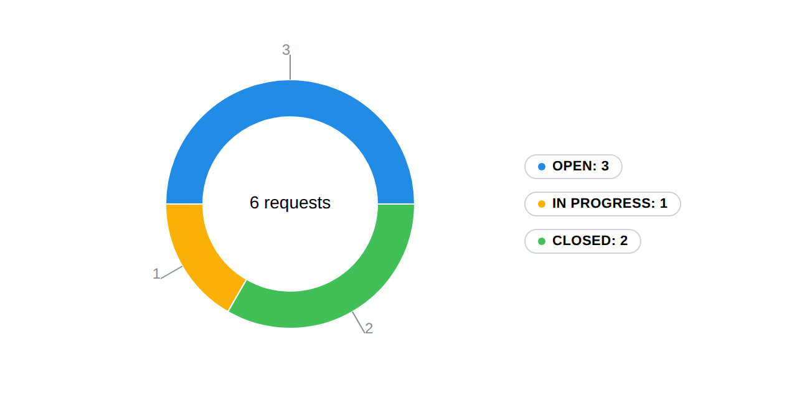

```tsx
<DonutChart
    withLabels
    chartLabel="6 requests"
    data={[
        { name: "Open", value: 3, color: "blue.6" },
        { name: "In Progress", value: 1, color: "yellow.6" },
        { name: "Closed", value: 2, color: "green.6" },
    ]}
/>
```

Donut charts are hard to read with more than five or six slices. Use a bar chart instead when there are many groups.

***

### LineChart

A `LineChart` shows how values change over time. It uses `dataKey` and `series` the same way as `BarChart`.

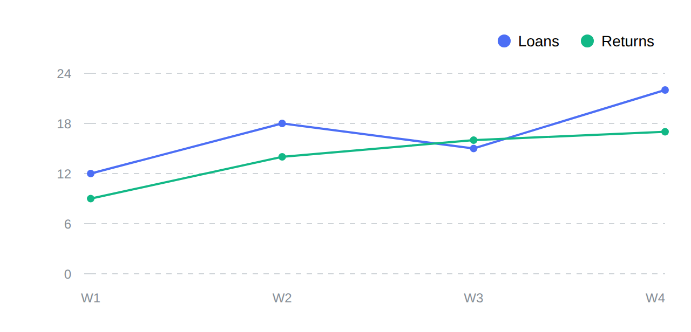

```tsx
<LineChart
    h={300}
    data={weeks}
    dataKey="week"
    withLegend
    series={[
        { name: "loans", label: "Loans", color: "indigo.6" },
        { name: "returns", label: "Returns", color: "teal.6" },
    ]}
/>
```

Charts are hard or impossible to read for some people, so show the same numbers as text too: a list of counts, or a `Table` under the chart.

---

## Component Libraries and Design

Component libraries speed up UI work, but good design choices are still needed:

- Choose the right component for the task (card vs table vs list)
- Maintain consistent spacing with `Stack` and `Group` layout components
- Use appropriate variants (`outline` for secondary actions, filled for primary)
- Keep accessibility in mind — Mantine gives you a good foundation but you still need to provide labels and alt text

---

## Replacing Plain UI with Mantine

Before (plain HTML elements):

```tsx
<button onClick={handleSave}>Save</button>
<div className="my-card">
    <h3>Product Name</h3>
</div>
```

After (Mantine components):

```tsx
import { Button, Card, Text, Title } from "@mantine/core";

<Button onClick={handleSave}>Save</Button>
<Card shadow="sm" padding="lg">
    <Title order={3}>Product Name</Title>
</Card>
```

---

## Key Differences from Other Libraries

- **npm package** — not copied into your project, installed as a dependency
- **Built-in hooks** — `@mantine/hooks` provides `useDisclosure`, `useToggle`, `useDebouncedValue`, and more
- **CSS resets included** — styles are applied globally through `@mantine/core/styles.css`
- **Rich theming** — use `MantineProvider` to set colours, fonts, and spacing globally

---

## Summary

- Install Mantine with `npm install @mantine/core @mantine/hooks`
- Wrap your app in `MantineProvider` and import `@mantine/core/styles.css`
- Import components from `@mantine/core` and use props like `variant` to customise
- Provides buttons, cards, forms, modals, tables, notifications, charts, and more
- Give icon-only buttons an `aria-label`, put status text inside badges, and show chart numbers as text too
- Components give you a good starting point but design decisions are still yours

### Activity - Mantine Component Library

[Attempt Activity - Mantine Component Library](../../tasks/mantine-components.md){.md-button}

[Attempt Activity - Mantine Form Inputs](../../tasks/mantine-form-inputs.md){.md-button}

[Attempt Activity - Mantine Form Validation](../../tasks/mantine-form-validation.md){.md-button}

[Attempt Activity - Mantine Modals and Notifications](../../tasks/mantine-feedback.md){.md-button}

[Attempt Activity - Mantine Tables and Filters](../../tasks/mantine-tables-filters.md){.md-button}

[Attempt Activity - Mantine Charts](../../tasks/mantine-charts.md){.md-button}

[Attempt Activity - Mantine Equipment Loans](../../tasks/mantine-equipment-loans.md){.md-button}
