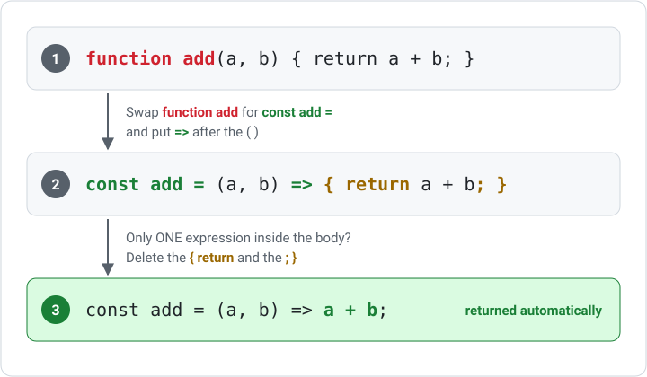

# Arrow Functions

Arrow functions are a shorter syntax for writing functions in JavaScript and TypeScript. React code uses them everywhere: for components, for click handlers like `onClick={() => …}`, and for array methods like `.map((item) => …)`. They are short enough to write right where you need them, so you will type hundreds of them.

---

## What is a Function?

A function is a named set of instructions you can run whenever you want. You give it some values (called **parameters**), it does some work, and it can hand a value back with `return`. You run it by writing its name followed by brackets, like `add(3, 4)`.

```tsx
function add(a: number, b: number) {
    return a + b;
}

add(3, 4); // gives back 7
```

The `: number` after each parameter is TypeScript. It says what type of value the parameter must be. TypeScript needs it on every parameter.

***

## Traditional vs Arrow Syntax

An arrow function does the same job as a normal function. Instead of the word `function`, you store the function in a `const` and put an arrow `=>` between the parameters and the body.

Traditional function:

```tsx
function add(a: number, b: number) {
    return a + b;
}
```

Arrow function:

```tsx
const add = (a: number, b: number) => {
    return a + b;
};
```

***

## Block Body or Implicit Return

An arrow function can be written two ways:

- **Block body:** the body is inside `{ }`, and you must write `return` to give a value back. Use this when the function needs more than one line.
- **Implicit return:** no `{ }` and no `return`. Whatever comes after the `=>` is given back automatically. Use this when the function is a single expression.

```tsx
// 1. Function declaration
function add(a: number, b: number) {
    return a + b;
}

// 2. Arrow function, block body: curly braces AND `return`
const add = (a: number, b: number) => {
    return a + b;
};

// 3. Arrow function, implicit return: NO braces, NO `return`
const add = (a: number, b: number) => a + b;
```



!!! warning "Braces without return"
    A block body with no `return` gives back `undefined`. If a function "returns nothing" when you expected a value, check for braces that are missing a `return`.

***

## Single Parameter

If there is exactly one parameter, the parentheses can be left off in plain JavaScript:

```javascript
const double = n => n * 2;
```

In TypeScript you usually need a type on the parameter, which requires the brackets: `(n: number) => n * 2`. Inside callbacks like `.map()`, TypeScript can often work out the type for you, so you will see both `(item) => …` and `item => …`.

***

## Returning Objects

An arrow function with an implicit return can't return an object `{ }` straight away, because JavaScript reads the braces as a block body. Wrap the object in **parentheses**:

```tsx
// INCORRECT - the braces are read as a block body
const makePoint = (x: number, y: number) => { x: x, y: y };

// CORRECT - parentheses around the object
const makePoint = (x: number, y: number) => ({ x: x, y: y });
```

***

## Template Literals

A template literal is a string written with backticks `` ` `` instead of quotes. Inside it, `${ }` drops a value straight into the text. These two lines make the same string:

```tsx
"Hello, " + name + "!"
`Hello, ${name}!`
```

Template literals pair well with implicit-return arrow functions:

```tsx
const greet = (name: string) => `Hello, ${name}!`;
```

***

## Components as Arrow Functions

A React component is a function that returns JSX. Its name must start with a capital letter, and you use it like a tag: a component called `Header` is used as `<Header />`. Components can be written as arrow functions too:

```tsx
// Function declaration
function Header() {
    return <h1>My Site</h1>;
}

// Arrow function, block body
const Header = () => {
    return <h1>My Site</h1>;
};

// Arrow function, implicit return
const Header = () => <h1>My Site</h1>;
```

An arrow component is exported on its own line:

```tsx
const HomePage = () => {
    return (
        <main>
            <h1>Home</h1>
        </main>
    );
};

export default HomePage;
```

### Props

Values you pass to a component, like `<Greeting name="Alex" />`, are called **props**. The component receives them as one object:

```tsx
const Greeting = (props: { name: string }) => <p>Welcome back, {props.name}!</p>;
```

**Destructuring** pulls `name` straight out of the props object in the brackets, so you can write `name` instead of `props.name`:

```tsx
const Greeting = ({ name }: { name: string }) => <p>Welcome back, {name}!</p>;
```

***

## Arrow Functions in Event Handlers

`onClick` needs a **function** that React can run later, when the button is clicked:

```tsx
<button onClick={() => setCount(count + 1)}>Add</button>
```

Passing arguments to a handler also needs an arrow function wrapper:

```tsx
<button onClick={() => handleDelete(item.id)}>Delete</button>
```

Without the wrapper, `handleDelete(item.id)` would run immediately when the page renders, rather than on click. See [Events and State](events-and-state.md) for more.

***

## Arrow Functions in Array Methods

Arrow functions make array operations short and readable:

```tsx
const prices = [10, 20, 30];

const withTax = prices.map((price) => price * 1.1);

const affordable = prices.filter((price) => price < 25);

const total = prices.reduce((sum, price) => sum + price, 0);
```

See [Lists with map and filter](lists-map-filter.md) for using these in React.

***

## Refactoring to Arrow Functions

Before (traditional function):

```tsx
function handleSubmit(event: React.FormEvent) {
    event.preventDefault();
    console.log("Submitted");
}
```

After (arrow function):

```tsx
const handleSubmit = (event: React.FormEvent) => {
    event.preventDefault();
    console.log("Submitted");
};
```

The arrow function is assigned to a `const`, making it clear that `handleSubmit` should not be reassigned.

***

## Summary

- Arrow functions provide a shorter syntax: `(params) => { body }`
- A block body needs `return`; an implicit return has no braces and no `return`
- Wrap an object in `( )` to return it from an implicit-return arrow function
- Components can be arrow functions; destructure props with `({ name }: { name: string })`
- Wrap handlers in an arrow function when you need to pass arguments: `onClick={() => remove(id)}`
- Arrow functions are the standard callback for `.map()`, `.filter()`, and `.reduce()`
