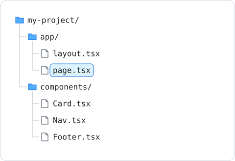

# Components and Layouts

Components and layouts are the building blocks of a Next.js application. Components make your code reusable, while layouts provide shared structure across pages.

---

## What is a Component?

A component is a reusable piece of UI. In Next.js, components are functions that return JSX (HTML-like syntax):

```tsx
export default function Greeting() {
    return <h2>Welcome to our site!</h2>;
}
```

Components can accept **props** (properties) to make them flexible:

```tsx
interface CardProps {
    title: string;
    description: string;
}

export default function Card({ title, description }: CardProps) {
    return (
        <div style={{ border: "1px solid #ccc", padding: "1rem" }}>
            <h3>{title}</h3>
            <p>{description}</p>
        </div>
    );
}
```

---

## Using Components

Once defined, components can be used like HTML tags:

```tsx
import Card from "./components/Card";

export default function HomePage() {
    return (
        <main>
            <Card title="Latte" description="Smooth espresso with steamed milk." />
            <Card title="Cappuccino" description="Espresso with foamed milk." />
        </main>
    );
}
```

---

## Organising Components

Components are typically placed in a `components/` folder at the root of your project:



---

## Layouts

The layout component wraps all pages with shared UI (navigation, footer, etc.):

```tsx
// app/layout.tsx
import Nav from "../components/Nav";

export default function RootLayout({ children }: { children: React.ReactNode }) {
    return (
        <html lang="en">
            <body>
                <Nav />
                <main>{children}</main>
                <footer>2026 My Cafe</footer>
            </body>
        </html>
    );
}
```

- `children` is a special prop that represents whatever page content gets rendered
- The layout is applied to every page in the app
- Navigation and footers only need to be written once

---

## Reusable Components vs Layouts

| Component | Layout |
|---|---|
| Used anywhere on any page | Wraps all pages automatically |
| Imported explicitly | Defined in `layout.tsx` |
| Flexible placement | Consistent structure across the app |

Both help you follow the **DRY** principle: Don't Repeat Yourself.

---

## Summary

- Components are reusable pieces of UI, accepting props for flexibility
- Place components in a `components/` folder
- Layouts in `layout.tsx` provide shared structure for all pages
- The `children` prop in layouts represents the current page content

For props on interactive components (default values, `children` in your own components, and function props like `onChange`), see [Component Props](component-props.md).

### Activity - Components

[Attempt Activity - Components](../../tasks/components-props.md){.md-button}

### Activity - Next.js App with Routing

[Attempt Activity - Next.js App with Routing](../../tasks/nextjs-routing-app.md){.md-button}
