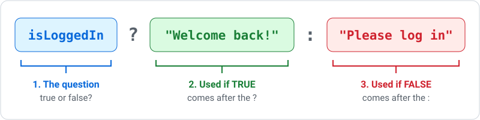
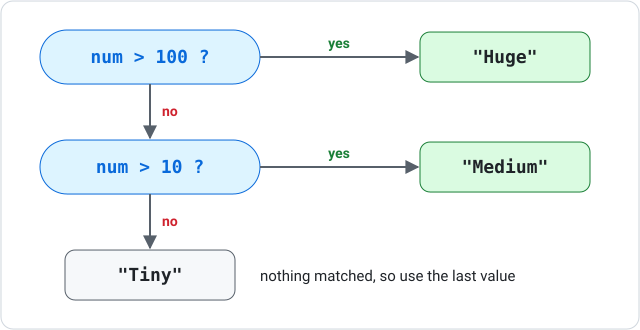

# Conditional Rendering

Conditional rendering means showing different things depending on the situation: a "Log out" button when someone is logged in, a loading message while data arrives, a red badge for sold-out products. This resource covers the **ternary operator**, `&&`, and `null`, which are the tools React code uses to make those choices.

---

## Why Not Just Use if?

An `if` statement **runs code**. It does not produce a value, so it cannot go inside JSX curly braces `{ }`:

```tsx
// INCORRECT - an if statement is not allowed inside JSX
return <p>{if (isLoggedIn) { "Welcome back!" }}</p>;
```

React needs something that **produces a value** that can be dropped into the JSX. That is what the ternary operator does.

***

## The Ternary Operator

The ternary operator asks a true/false question and picks one of two values depending on the answer. "Ternary" means "made of three parts": the question, the value if true, and the value if false.

```tsx
condition ? valueIfTrue : valueIfFalse
```



These two snippets do exactly the same thing:

```tsx
let message;
if (isLoggedIn) {
    message = "Welcome back!";
} else {
    message = "Please log in";
}

const message = isLoggedIn ? "Welcome back!" : "Please log in";
```

***

## Three Places to Use a Ternary

You will see ternaries written in three common places:

```tsx
// A. Stored in a variable, then used in JSX
const message = isLoggedIn ? "Welcome back!" : "Please log in";
return <p>{message}</p>;

// B. Directly inside the JSX
return <p>{isLoggedIn ? "Welcome back!" : "Please log in"}</p>;

// C. Inside an arrow function you call from the JSX
const getMessage = (loggedIn: boolean) => (loggedIn ? "Welcome back!" : "Please log in");
return <p>{getMessage(isLoggedIn)}</p>;
```

All three give the same result. Pick the one that is easiest to read in each situation.

***

## Common Ternary Examples

### Plurals

```tsx
<p>{count} {count === 1 ? "item" : "items"}</p>
```

### Template literals

A template literal is a string written with backticks. Inside it, `${ }` drops a value into the text:

```tsx
<button>{name === "" ? "Enter a name first" : `Sign up as ${name}`}</button>
```

### Numbers

```tsx
<p>{num % 2 === 0 ? "Even" : "Odd"}</p>
<p>{product.price === 0 ? "Free" : `$${product.price}`}</p>
```

In `` `$${product.price}` `` the first `$` is just a dollar sign. The `${ }` part inserts the value.

***

## Ternaries in Attributes

A ternary can produce **any** value, so it can be used for attributes as well as text:

```tsx
// className
<button className={liked ? "text-red-600" : "text-gray-500"}>Like</button>

// style
<p style={{ color: isError ? "red" : "green" }}>Status</p>

// type
<input type={showPassword ? "text" : "password"} />

// placeholder
<input placeholder={isGamer ? "e.g. xX_Slayer_Xx" : "e.g. jsmith"} />
```

### A condition is already true or false

For attributes that need `true` or `false`, such as `disabled`, you do not need a ternary at all:

```tsx
<button disabled={name === "" ? true : false}>Submit</button>   // works, but...
<button disabled={name === ""}>Submit</button>                  // ...this is the same thing
```

`name === ""` is already `true` or `false`, so `? true : false` adds nothing.

***

## Choosing Which Component to Show

A ternary can return whole chunks of JSX, including components:

```tsx
{isLoggedIn ? <Dashboard /> : <LoginForm />}
```

This is how you swap one part of a page for another, such as a login button and a logout button.

### Fragments

Each side of a ternary can only return **one** element. To return several, wrap them in a **fragment** `<> </>`. A fragment groups elements without adding an extra `<div>` to the page:

```tsx
{book ? (
    <>
        <h1>{book.title}</h1>
        <p>{book.author}</p>
    </>
) : (
    <p>Book not found.</p>
)}
```

***

## Show Something or Nothing

Sometimes you want to show something **or nothing at all**. There are two ways to write this.

### Using null

`null` means "nothing". If a ternary returns `null`, React shows nothing in that spot:

```tsx
{showDetails ? <p>Details here</p> : null}
```

### Using &&

`&&` means "and". React looks at the left side first. If it is `false`, nothing is shown. If it is `true`, React shows whatever is on the right:

```tsx
{showDetails && <p>Details here</p>}
{isAdmin && <p>Welcome, admin</p>}
```

The two lines above do the same job as the `null` version, but `&&` is shorter.

### The && gotcha

Only put a true/false value on the left of `&&`. A number on the left can show up on the page:

```tsx
// INCORRECT - when count is 0, the page shows a lonely "0"
{count && <p>You have {count} items</p>}

// CORRECT - count > 0 is true or false
{count > 0 && <p>You have {count} items</p>}
```

***

## Nested Ternaries

When there are more than two options, you can chain ternaries:

```tsx
const size = num > 100 ? "Huge" : num > 10 ? "Medium" : "Tiny";
```

Spread long ones over several lines so they are easier to read:

```tsx
const size =
    num > 100 ? "Huge"
    : num > 10 ? "Medium"
    : "Tiny";
```

A nested ternary is a chain of questions, and it stops at the **first** "yes":



!!! warning "Order matters"
    If you asked `num > 10` first, `500` would stop there and give `"Medium"`. Always check the most specific condition first.

### When not to nest

Nested ternaries are fine for two or three options, such as loading / error / data. Past that, a small function with `if` statements and early `return`s is usually easier to read:

```tsx
const getTempLabel = (t: number) => {
    if (t >= 30) return "Hot";
    if (t >= 20) return "Warm";
    if (t >= 10) return "Cool";
    return "Cold";
};
```

See [Choosing Arrows, Ternaries and if](choosing-syntax.md) for more on picking the right tool.

***

## Summary

- An `if` statement cannot go inside JSX; a ternary can, because it produces a value
- The shape is `condition ? valueIfTrue : valueIfFalse`
- Ternaries can choose text, attributes (`className`, `style`, `type`), or whole components
- Use `&&` (or `? ... : null`) to show something or nothing, with a true/false value on the left
- Wrap several elements in a fragment `<> </>` when one side of a ternary needs them
- Nested ternaries stop at the first true condition; switch to `if` statements past three options

### Activity - Ternary Basics

[Attempt Activity - Ternary Basics](../../tasks/ternary-basics.md){.md-button}

### Activity - Ternaries for Attributes and Components

[Attempt Activity - Ternaries for Attributes and Components](../../tasks/ternary-attributes-components.md){.md-button}
