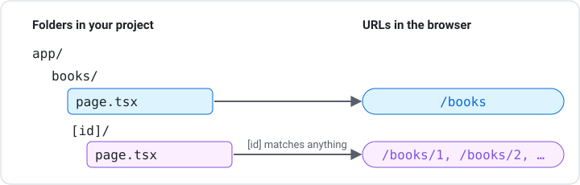
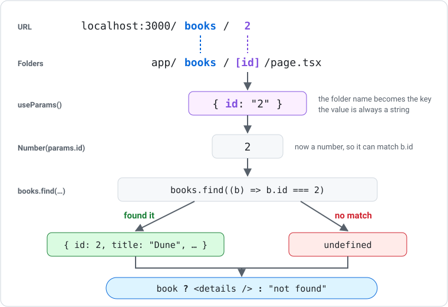

# Dynamic Routes and useParams

A shop with 500 products can't have 500 folders. A **dynamic route** is one page that handles many URLs. This resource covers how to create dynamic routes, read the URL with `useParams`, find the matching item, and handle items that don't exist.

---

## What is a Dynamic Route?

So far every page has had a fixed address: `app/about/page.tsx` is always `/about`. A dynamic route uses a folder name in **square brackets**, like `[id]`, and that part of the URL can be anything: `/books/1`, `/books/2`, `/books/banana`. The same `page.tsx` handles all of them and works out what to show from the URL.



![app/books/page.tsx is the list at /books; app/books/[id] holds loading.tsx and page.tsx for /books/1, /books/2 and any other value](../../../assets/diagrams/structure-books-dynamic.svg)

***

## Reading the URL with useParams

`useParams` is a hook from Next.js. It reads the current URL and gives you an object with one property for each square-bracket folder. On `/books/2`, the folder `[id]` gives you `{ id: "2" }`.

Like other hooks, you call it at the top of your component, and it only works in client components:

```tsx
"use client";

import { useParams } from "next/navigation";

const BookPage = () => {
    const params = useParams<{ id: string }>();
    return <p>You asked for book {params.id}</p>;
};

export default BookPage;
```

- Import `useParams` from `next/navigation` (not from `react`)
- `useParams<{ id: string }>()` tells TypeScript which properties to expect
- The property name matches the folder name: `[id]` gives `params.id`

!!! warning "params.id is always a string"
    `params.id` is `"2"`, not `2`. Use `Number(params.id)` when comparing it with a number id.

***

## Every [id] Folder Needs a loading.tsx

Next.js tries to prepare each page before anyone visits it. A `[id]` page can't be prepared early, because nobody knows the id until someone types the URL. If there's no `loading.tsx`, you'll see this error in the terminal and a red error badge in the browser:

```text
Error: Route "/books/[id]": Next.js encountered URL data `useParams()` in a Client Component outside of `<Suspense>`.
```

To fix it, put a `loading.tsx` file next to the `page.tsx`. Next.js shows it for the split second before the id is known:

```tsx
// app/books/[id]/loading.tsx
const Loading = () => <p>Loading…</p>;

export default Loading;
```

Whenever you make a `[something]/page.tsx` that uses `useParams`, **make a `loading.tsx` next to it**.

***

## From URL to Item

The usual pattern is: read the id from the URL, find the matching item, then use a ternary to show it or a "not found" message.



```tsx
"use client";

import Link from "next/link";
import { useParams } from "next/navigation";
import { books } from "@/app/data";

const BookPage = () => {
    const params = useParams<{ id: string }>();
    const book = books.find((b) => b.id === Number(params.id));

    return (
        <main>
            {book ? (
                <>
                    <h1>{book.title}</h1>
                    <p>by {book.author}</p>
                </>
            ) : (
                <p>Sorry, no book with id {params.id}.</p>
            )}
            <Link href="/books">← Back to books</Link>
        </main>
    );
};

export default BookPage;
```

- `.find()` returns `undefined` when nothing matches, such as `/books/99`
- The ternary shows the book or a "not found" message
- The fragment `<> </>` lets one side of the ternary return several elements

***

## Linking to a Dynamic Route

On the list page, build each link with a template literal:

```tsx
{books.map((book) => (
    <li key={book.id}>
        <Link href={`/books/${book.id}`}>{book.title}</Link>
    </li>
))}
```

***

## Choosing the Param Name

You choose the name in the square brackets, and it becomes the property name in `useParams`:

| Folder | URL | useParams gives |
|---|---|---|
| `app/books/[id]/` | `/books/3` | `{ id: "3" }` |
| `app/students/[studentId]/` | `/students/101` | `{ studentId: "101" }` |
| `app/blog/[slug]/` | `/blog/first-post` | `{ slug: "first-post" }` |

If the folder name and the property name don't match, the value will be `undefined`.

***

## Exact Routes Win

A normal folder beats a dynamic one. If you have both `app/pets/new/` and `app/pets/[id]/`, visiting `/pets/new` shows the `new` page. Next.js always prefers an exact match to a dynamic one.

***

## Dynamic Routes with fetch

When the data comes from an API, fetch inside `useEffect` and put `params.id` in the dependency array, so the fetch runs again if the id changes:

```tsx
useEffect(() => {
    fetch(`https://dummyjson.com/products/${params.id}`)
        .then((res) => {
            if (!res.ok) throw new Error(`Error ${res.status}`);
            return res.json();
        })
        .then((data: Product) => setProduct(data))
        .catch((err: Error) => setError(err.message))
        .finally(() => setLoading(false));
}, [params.id]);
```

A detail page that fetches usually has **four** states: loading, error, not found, and the item. See [Handling Loading and Error States](loading-error-states.md).

***

## The params Prop (Server Components)

Server components can read dynamic values without `useParams`. Next.js passes them in a `params` prop, which is a **Promise**, so the component must be `async` and `await` it:

```tsx
// app/books/[id]/page.tsx  (no "use client")
export default async function BookPage({ params }: { params: Promise<{ id: string }> }) {
    const { id } = await params;
    return <h1>Book {id}</h1>;
}
```

Use the `params` prop for simple server pages, and `useParams` when the page is a client component (it uses state, effects, or event handlers). The tasks on this site mostly use `useParams`.

***

## Summary

- A folder named `[id]` creates one page that handles many URLs
- `useParams<{ id: string }>()` reads the value from the URL in a client component
- `params.id` is always a string; convert with `Number()` before comparing to numbers
- Add a `loading.tsx` next to every `[id]/page.tsx` that uses `useParams`
- Use `.find()` to get the matching item and a ternary to handle "not found"
- In server components, read the `params` prop with `await`

### Activity - Dynamic Routes with useParams

[Attempt Activity - Dynamic Routes with useParams](../../tasks/dynamic-routes-useparams.md){.md-button}

### Activity - User Directory App

[Attempt Activity - User Directory App](../../tasks/user-directory.md){.md-button}
