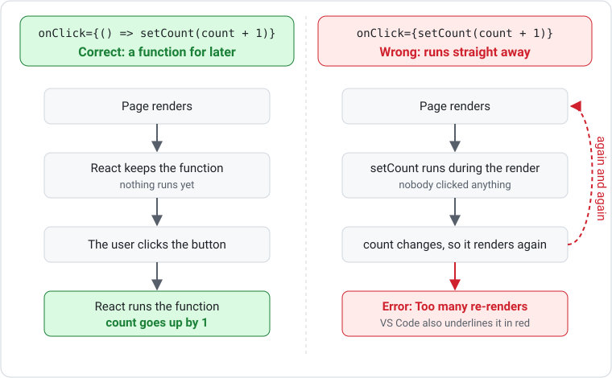

# Events and State

Interactive web applications respond to user actions. In Next.js/React, you use **events** to detect actions and **state** to track changes.

Both events and state require a **client component**. Add `"use client"` as the first line of any file that uses them (see [Client and Server Components](client-server-components.md)).

---

## Event Handling in React

Events are how the browser tells your code what the user did. A `<button>` on its own renders but does nothing when clicked — attaching an `onClick` handler is what connects a user action to your code.

React uses camelCase event names passed as props:

```tsx
"use client";

export default function Button() {
    function handleClick() {
        console.log("Button clicked!");
    }

    return <button onClick={handleClick}>Click me</button>;
}
```

Common events:

| Event | Trigger |
|---|---|
| `onClick` | Mouse click |
| `onChange` | Input value changes |
| `onSubmit` | Form submission |
| `onMouseEnter` | Mouse enters element |

---

## What is State?

State is data that can change over time. It exists because a plain JavaScript variable is reset on every render and would never update the screen — React does not watch ordinary variables. Change state through its setter, though, and React re-renders the component to reflect the new value.

```tsx
"use client";

import { useState } from "react";

export default function Counter() {
    const [count, setCount] = useState(0);

    function increment() {
        setCount(count + 1);
    }

    return (
        <div>
            <p>Count: {count}</p>
            <button onClick={increment}>Increase</button>
        </div>
    );
}
```

- `useState(0)` creates a state variable called `count` with an initial value of `0`
- `setCount` is the function used to update the value
- When `setCount` is called, the component re-renders with the new value

---

## Building Interactive Components

Small interactive components are great practice. Here are common examples:

### Counter

```tsx
const [count, setCount] = useState(0);
```

### Toggle

```tsx
const [isOn, setIsOn] = useState(false);

function toggle() {
    setIsOn(!isOn);
}
```

### Filter

```tsx
const [search, setSearch] = useState("");

let filtered = items.filter(item =>
    item.name.toLowerCase().includes(search.toLowerCase())
);
```

### Favourites

```tsx
const [favourites, setFavourites] = useState<string[]>([]);

function toggleFavourite(id: string) {
    if (favourites.includes(id)) {
        setFavourites(favourites.filter(f => f !== id));
    } else {
        setFavourites([...favourites, id]);
    }
}
```

---

## Events and State Together

Events trigger state changes, and state changes update the UI:

```tsx
"use client";

import { useState } from "react";

export default function ToggleMessage() {
    const [visible, setVisible] = useState(false);

    return (
        <div>
            <button onClick={() => setVisible(!visible)}>
                Toggle
            </button>
            {visible && <p>Now you see me!</p>}
        </div>
    );
}
```

---

## Passing vs Calling a Handler

`onClick` needs a **function** that React can run later, when the button is clicked:

```tsx
onClick={() => setCount(count + 1)}   // a function that runs on click
onClick={increment}                   // pass a named function (no brackets)

onClick={setCount(count + 1)}         // INCORRECT - runs immediately, every render
onClick={increment()}                 // INCORRECT - calls it during render
```



To pass an argument, wrap the call in an arrow function:

```tsx
<button onClick={() => addAmount(5)}>+5</button>
<button onClick={() => handleDelete(item.id)}>Delete</button>
```

---

## Updater Functions

Instead of giving the setter a new value, you can give it an **updater function**: an arrow function that receives the newest value (usually called `prev`, short for "previous") and returns the new one.

```tsx
setCount((prev) => prev + 1);
setIsOn((prev) => !prev);
```

This matters when you update the same state more than once in a row:

```tsx
// INCORRECT - only adds 1
const addTwo = () => {
    setCount(count + 1);
    setCount(count + 1);
};

// CORRECT - adds 2
const addTwo = () => {
    setCount((prev) => prev + 1);
    setCount((prev) => prev + 1);
};
```

`count` is a snapshot that stays the same until the next render, while `prev` is always the latest value.


Use the updater form whenever the new value depends on the old one.

---

## Text Inputs and Checkboxes

An input whose value comes from state is called a **controlled input**. The `onChange` handler copies what the user typed into state:

```tsx
const [name, setName] = useState("");

<input value={name} onChange={(e) => setName(e.target.value)} />
<p>Hello, {name}</p>
```

As a named handler, the event needs a TypeScript type:

```tsx
const handleNameChange = (e: React.ChangeEvent<HTMLInputElement>) => {
    setName(e.target.value);
};
```

Number inputs give you a string, so convert it with `Number()`:

```tsx
<input type="number" value={age} onChange={(e) => setAge(Number(e.target.value))} />
```

Checkboxes use `checked` and `e.target.checked` instead of `value`:

```tsx
<input type="checkbox" checked={agreed} onChange={(e) => setAgreed(e.target.checked)} />
```

---

## Typing State

TypeScript usually works out the type of state from its starting value. When it can't, or when you want to restrict the allowed values, add the type in angle brackets:

```tsx
const [items, setItems] = useState<string[]>([]);
const [error, setError] = useState<string | null>(null);
const [light, setLight] = useState<"red" | "yellow" | "green">("red");
```

---

## Summary

- Events like `onClick` let you respond to user actions
- `useState` creates state that persists across renders
- Changing state with the setter function triggers a re-render
- Combine events and state to build interactive components
- Pass handlers to `onClick` without calling them; wrap them in an arrow function to pass arguments
- Use an updater function (`prev => prev + 1`) when the new value depends on the old one
- Controlled inputs read from state with `value` and write to it with `onChange`

### Activity - Interactive Component

[Attempt Activity - Interactive Component](../../tasks/interactive-component.md){.md-button}

### Activity - Arrow Functions, Events and State

[Attempt Activity - Arrow Functions, Events and State](../../tasks/arrow-functions-events-state.md){.md-button}
