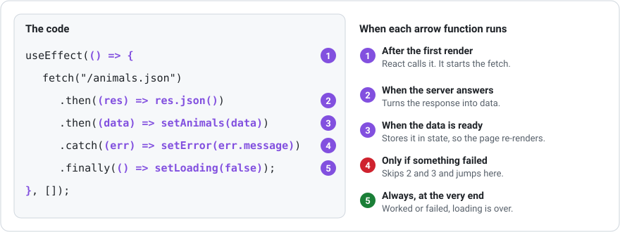

# Fetching Data

Fetching data from APIs is a core skill for building dynamic web applications. This page covers Promises, making requests with `fetch`, checking responses, and handling errors. Most examples use the `.then()` style, which keeps the flow of data visible in one chain. The `async` / `await` style is covered at the end.

---

## What is Asynchronous Code?

Most of your code runs synchronously (one line after another). Network requests are different. They take time, and you can't freeze the whole page while waiting.

**Asynchronous** code lets you start a request and continue running other code while waiting for the response.

***

## Promises

Loading data takes time, so a loading function can't give you the data straight away. It gives you a **Promise** instead: an object that says "I'll have your value later, or I'll tell you it failed". You attach arrow functions to the Promise to say what should happen when it finishes:

| Method | Its arrow function runs when… | You usually… |
| --- | --- | --- |
| `.then((data) => …)` | the Promise worked, and `data` is the value | save the data with a setter |
| `.catch((err) => …)` | the Promise failed, and `err` is the error | save `err.message` to show it |
| `.finally(() => …)` | it finished, whether it worked or failed | set `loading` to `false` |

You chain them one after another: `getData().then(…).catch(…).finally(…)`.

***

## Fetch with .then()

`fetch()` is built into the browser. You give it a URL and it returns a Promise. The answer arrives in two steps:

1. First you get a **response**: the envelope, with a status code like `200` (OK) or `404` (not found).
2. Then you open the envelope with `res.json()`, which turns the text inside into a JavaScript array or object. This is **another** Promise, so it needs another `.then()`.

```typescript
fetch("https://dummyjson.com/products")
    .then((res) => res.json())
    .then((data) => console.log(data))
    .catch((err) => console.error("Fetch failed:", err));
```

- `fetch()` starts the request
- The first `.then()` receives the response and parses it as JSON
- The second `.then()` receives the parsed data
- `.catch()` handles any errors

***

## Checking the Response

`fetch` only fails (and jumps to `.catch()`) when the network itself fails. A `404 Not Found` or `500 Server Error` still counts as an answer, so you must check `res.ok` yourself:

```typescript
fetch("https://dummyjson.com/products")
    .then((res) => {
        if (!res.ok) throw new Error(`Error ${res.status}`);
        return res.json();
    })
    .then((data) => console.log(data))
    .catch((err: Error) => console.error(err.message));
```

- `res.ok` is `true` for successful status codes (200 to 299)
- `throw` stops the chain and jumps straight to `.catch()`, carrying the error with it
- `res.status` is the number, such as `404`

You may also see this written as a ternary:

```typescript
.then((res) => (res.ok ? res.json() : Promise.reject(new Error(`Error ${res.status}`))))
```

Both versions do the same job.

***

## Every Arrow in a Fetch

A typical `useEffect` that loads data contains more arrow functions than you might think, each running at a different time:



You never call any of these yourself. You **hand them over**, and React or the Promise calls them at the right moment. That's why they have to be functions: `() => …` means "here's some code to run later".

***

## Understanding JSON Responses

The response body is text. `.json()` parses it into objects you can use:

```typescript
fetch("https://dummyjson.com/products/1")
    .then((res) => res.json())
    .then((product) => {
        console.log(product.title);
        console.log(product.price);
    });
```

In TypeScript, describe the shape of the data with a `type` so you get autocomplete and error checking:

```typescript
type Product = {
    id: number;
    title: string;
    price: number;
};

fetch("https://dummyjson.com/products/1")
    .then((res) => res.json())
    .then((product: Product) => console.log(product.title));
```

***

## Fetching Your Own Files

Files you put in the `public` folder can be fetched by name. `public/pets.json` is available at `/pets.json`:

```typescript
fetch("/pets.json")
    .then((res) => res.json())
    .then((pets: Pet[]) => console.log(pets));
```

This is a handy way to practise fetching before connecting to a real API. Visit `http://localhost:3000/pets.json` to check the file is being served.

***

## Connecting to Different Endpoints

The same fetch pattern works for any REST API. Change the URL and adjust the fields you display:

```typescript
fetch("https://dummyjson.com/users")
    .then((res) => res.json())
    .then((data) => console.log(data.users));

fetch("https://jsonplaceholder.typicode.com/todos?userId=1")
    .then((res) => res.json())
    .then((todos) => console.log(todos));
```

Free practice APIs:

- [DummyJSON](https://dummyjson.com): products, users, posts, recipes
- [JSONPlaceholder](https://jsonplaceholder.typicode.com): todos, posts, users, comments

Visit an API URL in your browser first to see the shape of the data.

***

## A Reusable Fetch Helper

If you write the same `res.ok` check over and over, put it in your own arrow function:

```typescript
const getJson = (url: string) =>
    fetch(url).then((res) => {
        if (!res.ok) throw new Error(`Error ${res.status}`);
        return res.json();
    });

getJson("/animals.json").then((animals: Animal[]) => console.log(animals));
```

`getJson` takes a URL, fetches it, and either opens the response as JSON or fails with the status code.

***

## Sending Data

`fetch` makes a `GET` request by default. To send data, add an options object with a `method`, `headers`, and a `body`:

```typescript
fetch("https://dummyjson.com/products/add", {
    method: "POST",
    headers: { "Content-Type": "application/json" },
    body: JSON.stringify({ title: "New product", price: 10 }),
})
    .then((res) => res.json())
    .then((created) => console.log(created));
```

`JSON.stringify` turns a JavaScript object into JSON text. See [Supabase REST API with fetch](../supabase/supabase-rest-api.md) for `PATCH` and `DELETE` examples.

***

## async and await

`async` and `await` are another way to work with Promises, without chaining `.then()`. Put `async` in front of an arrow function's brackets, and inside it write `await` in front of a Promise. `await` pauses that function until the Promise finishes, then gives you the value:

```typescript
const loadProducts = async () => {
    try {
        const res = await fetch("https://dummyjson.com/products");
        if (!res.ok) throw new Error(`Error ${res.status}`);
        const data = await res.json();
        console.log(data);
    } catch (err) {
        console.error(err instanceof Error ? err.message : "Something went wrong");
    } finally {
        console.log("Finished");
    }
};
```

| `.then()` style | `async` / `await` style |
|---|---|
| `.then((data) => …)` | `const data = await …` |
| `.catch((err) => …)` | `try { … } catch (err) { … }` |
| `.finally(() => …)` | `finally { … }` |

Both styles do exactly the same thing. TypeScript doesn't know the type of `err` in a `catch` block, which is why the example checks `err instanceof Error` before reading `err.message`.

***

## Summary

- `fetch()` returns a Promise; handle it with `.then()`, `.catch()`, and `.finally()`
- The response arrives in two steps: the response, then `res.json()`
- Check `res.ok` and `throw` an error for bad status codes
- Files in `public/` can be fetched by name, e.g. `/pets.json`
- Describe the shape of your data with a TypeScript `type`
- `async` / `await` with `try` / `catch` / `finally` is an alternative to `.then()` chains
