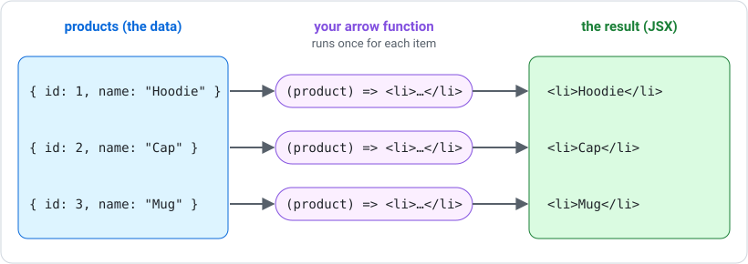
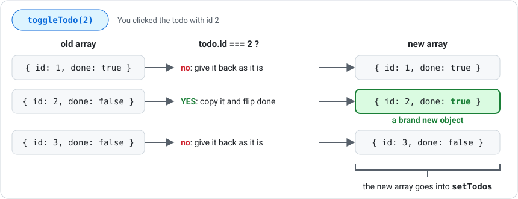

# Lists with map and filter

Almost every app displays a list: products, users, todos, pets. This resource covers how to turn an array of data into JSX with `.map()`, how to narrow it down with `.filter()` and `.find()`, and how to update arrays stored in state.

---

## Arrays

An array is a list of values in square brackets, kept in order. Each value can be anything, including an object:

```tsx
const names = ["Aisha", "Ben", "Chloe"];
const products = [
    { id: 1, name: "Hoodie", price: 59 },
    { id: 2, name: "Cap", price: 25 },
];
```

`names.length` tells you how many items there are (`3` here).

In TypeScript, you describe the shape of each item with a `type` and add `[]` to say "an array of these":

```tsx
type Product = {
    id: number;
    name: string;
    price: number;
};

const products: Product[] = [ /* ... */ ];
```

***

## map, filter and find

All three methods are built into every array, and each one takes an **arrow function** that runs once for every item:

| Method | Your arrow function returns | You get back |
| --- | --- | --- |
| `.map()` | something new for this item (e.g. some JSX) | a new array, the same length, full of the new things |
| `.filter()` | `true` to keep the item, `false` to drop it | a new array with only the kept items |
| `.find()` | `true` when it's the item you want | the **first** matching item, or `undefined` if none match |

```tsx
const doubled = [1, 2, 3].map((n) => n * 2);       // [2, 4, 6]
const big = [1, 5, 10].filter((n) => n > 3);       // [5, 10]
const firstBig = [1, 5, 10].find((n) => n > 3);    // 5
```

None of them change the original array. They always give you something new.

***

## Rendering a List with map

`.map()` runs your arrow function once for each item and collects whatever it returns into a new array. React then shows that array of JSX:



There are two ways to write the arrow function:

```tsx
// Block body: you MUST write `return`
<ul>
    {products.map((product) => {
        return <li key={product.id}>{product.name}</li>;
    })}
</ul>

// Implicit return: wrap the JSX in ( )
<ul>
    {products.map((product) => (
        <li key={product.id}>{product.name}</li>
    ))}
</ul>
```

You can also write a named arrow function and pass it to `.map()` by name:

```tsx
const renderProduct = (product: Product) => <li key={product.id}>{product.name}</li>;

<ul>{products.map(renderProduct)}</ul>
```

***

## The key Prop

When you use `.map()` to make a list of JSX, React needs a way to tell the items apart so it can update the right one when something changes. Give each item a `key` that is unique within the list. The item's `id` is perfect:

```tsx
<li key={product.id}>{product.name}</li>
```

If you forget it, the page still works, but you will see a warning in the browser console.

***

## Ternaries Inside map

Each item in a list can show something different by using a ternary inside the `.map()`:

```tsx
{products.map((product) => (
    <li key={product.id}>
        {product.name}: {product.inStock ? "In stock" : "Sold out"}
    </li>
))}
```

See [Conditional Rendering](conditional-rendering.md) for more on ternaries.

***

## Filtering a List

Use `.filter()` to create a smaller list, then `.map()` the result:

```tsx
const inStock = products.filter((p) => p.inStock);

<ul>
    {inStock.map((p) => (
        <li key={p.id}>{p.name}</li>
    ))}
</ul>
```

### Chaining filters

Each `.filter()` takes the list from the one before it, so you can chain several together. This is useful for combining a search box with filter buttons:

```tsx
const visible = products
    .filter((p) => (showSoldOut ? true : p.inStock))
    .filter((p) => p.name.toLowerCase().includes(search.toLowerCase()));
```

`.toLowerCase()` makes both sides lowercase, so searching "hoodie" still finds "Hoodie".

### Empty lists

If a filter matches nothing, show a message instead of an empty list:

```tsx
{visible.length === 0 ? (
    <p>No products found</p>
) : (
    <ul>{visible.map(renderProduct)}</ul>
)}
```

***

## Finding One Item

Use `.find()` when you want a single item, such as the product that matches an id from the URL:

```tsx
const product = products.find((p) => p.id === 3);
```

`.find()` returns `undefined` when nothing matches, so always check before using the result:

```tsx
{product ? <h1>{product.name}</h1> : <p>Product not found</p>}
```

***

## Tables

When you map into table rows, React needs a `<tbody>` between `<table>` and the rows, or you will get an error about invalid nesting:

```tsx
<table>
    <tbody>
        {students.map((s) => (
            <tr key={s.id}>
                <td>{s.name}</td>
                <td>{s.mark}</td>
            </tr>
        ))}
    </tbody>
</table>
```

***

## Updating Arrays in State

You must never change an array or object that is stored in state. Instead, make a **new copy** with the change in it and give that to the setter.

### Spread

The three dots `...`, called **spread**, copy everything out of an array or object:

```tsx
const list = [1, 2, 3];
const longer = [...list, 4];
// [1, 2, 3, 4]: everything from list, plus 4 on the end

const todo = { id: 2, text: "Learn ternaries", done: false };
const flipped = { ...todo, done: true };
// { id: 2, text: "Learn ternaries", done: true }: same id and text, new done
```

Read `{ ...todo, done: true }` as "copy everything from `todo`, then set `done` to `true`".

### Add, remove and update

The three common updates each use a different array tool:

| Change | Tool | Example |
|---|---|---|
| Add an item | spread | `setTodos((prev) => [...prev, newTodo])` |
| Remove an item | `.filter()` | `setTodos((prev) => prev.filter((t) => t.id !== id))` |
| Update one item | `.map()` with a ternary | `setTodos((prev) => prev.map((t) => (t.id === id ? { ...t, done: !t.done } : t)))` |

The update line reads: *"for each todo, if it's the one we clicked, give back a copy with `done` flipped, otherwise give it back unchanged."*



***

## Summary

- `.map()` turns each item into something new, such as JSX
- `.filter()` keeps the items your arrow function returns `true` for
- `.find()` returns the first match, or `undefined`
- Every item rendered by `.map()` needs a unique `key`, usually its `id`
- Chain `.filter()` calls to combine several filters, and show a message when nothing matches
- Never change arrays in state directly: add with spread, remove with `.filter()`, update with `.map()`
