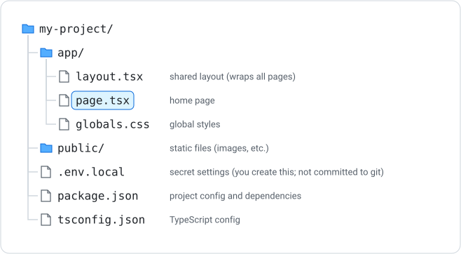

# Next.js Project Structure and TypeScript

Next.js is a React framework for building full-stack web applications. It adds routing, server-side rendering, and other features on top of React.

---

## What is Next.js?

Next.js is built on React and provides:

- File-based routing (no need to configure routes manually)
- Server-side rendering and static site generation
- API routes for backend logic
- Built-in optimisations

---

## Creating a New Project

```bash
npx create-next-app@latest my-project
```

You will be asked a few questions during setup. Choose **Yes, use recommended defaults**, which includes TypeScript, ESLint, Tailwind CSS and the App Router. See [What is Next.js](what-is-nextjs.md) for the full walkthrough.

This creates a folder called `my-project` with a standard project structure.

---

## Project Structure



The `app/` directory is where your pages and layouts live. Each folder in `app/` can become a route.

---

## TypeScript Basics

Next.js uses TypeScript by default. TypeScript adds type annotations to JavaScript:

```typescript
let name: string = "Alice";
let age: number = 25;
let isActive: boolean = true;
```

Type annotations are optional and help catch errors before your code runs.

### Interfaces

An interface defines the shape of an object:

```typescript
interface Product {
    id: number;
    title: string;
    price: number;
}

let item: Product = {
    id: 1,
    title: "Laptop",
    price: 999
};
```

### Typing Props

```typescript
interface CardProps {
    title: string;
    description: string;
}

export default function Card({ title, description }: CardProps) {
    return (
        <div>
            <h3>{title}</h3>
            <p>{description}</p>
        </div>
    );
}
```

---

## Running the Dev Server

From your project folder:

```bash
npm run dev
```

This starts a development server at `http://localhost:3000`. Changes to your code automatically refresh the page.

---

## Key Files

| File | Purpose |
|---|---|
| `app/layout.tsx` | Shared layout applied to all pages |
| `app/page.tsx` | Home page (route: `/`) |
| `app/about/page.tsx` | About page (route: `/about`) |
| `app/globals.css` | Global styles |
| `app/books/[id]/page.tsx` | Dynamic page (route: `/books/1`, `/books/2`, …) |
| `app/books/[id]/loading.tsx` | Shown while a page is loading |
| `app/components/Card.tsx` | A component (not a page, so no URL) |
| `public/data.json` | A static file (served at `/data.json`) |

Only files called `page.tsx` create routes. Any other `.tsx` file inside `app/` is just a module you can import.

---

## The @ Import Alias

`create-next-app` sets up a shortcut called an **import alias**. `@/` means "the root of the project", so you don't have to count `../` steps:

```typescript
// Without the alias (from app/books/[id]/page.tsx)
import { books } from "../../data";

// With the alias (works from any file)
import { books } from "@/app/data";
```

The tasks on this site use `@/app/...` imports.

---

## type vs interface

You will see both `type` and `interface` used to describe objects. For describing data and props they do the same job:

```typescript
interface Product {
    id: number;
    title: string;
}

type Product = {
    id: number;
    title: string;
};
```

A `type` can also describe a fixed set of values, which an `interface` cannot:

```typescript
type Species = "dog" | "cat" | "rabbit";
```

---

## Summary

- Next.js apps live in the `app/` directory with `layout.tsx` and `page.tsx` files
- TypeScript adds type annotations to help prevent errors
- Use interfaces to describe the shape of objects and props
- `npm run dev` starts the development server at `localhost:3000`
- Only `page.tsx` files create routes; `@/` imports from the project root

### Activity - Creating a Next.js App

[Attempt Activity - Creating a Next.js App](../../tasks/create-nextjs-app.md){.md-button}
