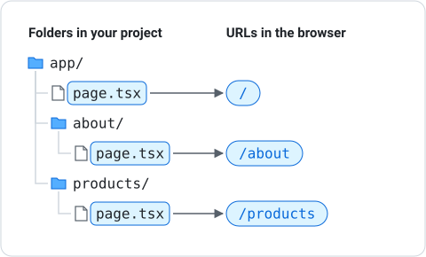

# Routing

Routing in Next.js is based on the file system. The folders and files inside `app/` determine which pages exist and how URLs map to them.

---

## How File-Based Routing Works

Many frameworks make you declare routes in a separate config file. Next.js skips that: it derives routes straight from the folders and files, so creating a page is as simple as creating a file, and there is no route table to keep in sync.

Every folder inside `app/` that contains a `page.tsx` file becomes a route:



---

## Static Routes

A static route is a page with a fixed URL. Create a folder and add a `page.tsx`:

```
app/about/page.tsx
```

```tsx
export default function AboutPage() {
    return (
        <main>
            <h1>About Us</h1>
            <p>Learn about our company.</p>
        </main>
    );
}
```

This page is available at `/about`.

---

## Dynamic Routes

Dynamic routes use square brackets for the folder name. They match any value at that segment:

![app/products/[id]/page.tsx handles /products/1, /products/42, /products/abc and any other value](../../../assets/diagrams/structure-dynamic-route.svg)

```tsx
interface Props {
    params: Promise<{ id: string }>;
}

export default async function ProductPage({ params }: Props) {
    const { id } = await params;

    return (
        <main>
            <h1>Product {id}</h1>
        </main>
    );
}
```

- The folder is named `[id]`
- Next.js passes the URL values in a `params` prop
- `params` is a **Promise**, so the component is `async` and uses `await params` to read it
- Visiting `/products/42` makes `id` equal `"42"` (always a string)

---

## The useParams Hook

The `params` prop works in server components. If your page is a **client component** (it uses hooks or event handlers), read the route value with the `useParams` hook instead:

```tsx
"use client";

import { useParams } from "next/navigation";

export default function ProductPage() {
    const params = useParams();

    return (
        <main>
            <h1>Product {params.id}</h1>
        </main>
    );
}
```

- Import `useParams` from `next/navigation`
- Add `"use client"` at the top of the file
- `params.id` holds the same value as the prop version, with no `await` needed

Use the `params` prop for simple server components, and `useParams` when the component is a client component.

!!! warning "Add a loading.tsx"
    A `[id]` page that uses `useParams` also needs a `loading.tsx` file next to it, or Next.js shows an error about `useParams()` being used outside of `<Suspense>`. See [Dynamic Routes and useParams](dynamic-routes.md) for the full pattern.

---

## Creating a Multi-Page Site

Here is what a site with two static routes and one dynamic route looks like:

![A site with a layout, a home page, /about, /menu, and a dynamic menu/[category] route for /menu/drinks and /menu/food](../../../assets/diagrams/structure-multi-page-site.svg)

---

## Linking Between Pages

Use the `<Link>` component instead of `<a>` tags for client-side navigation:

```tsx
import Link from "next/link";

export default function Nav() {
    return (
        <nav>
            <Link href="/">Home</Link>
            <Link href="/about">About</Link>
            <Link href="/menu">Menu</Link>
        </nav>
    );
}
```

`<Link>` enables fast page transitions without a full browser reload.

---

## Summary

- Static routes: create a folder with a `page.tsx` file
- Dynamic routes: use `[param]` folder names, read them with `await params` (server) or `useParams` (client)
- Use `<Link>` for navigating between pages
- The file system determines the URL structure
