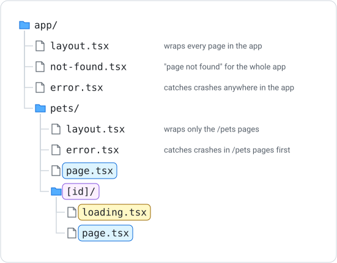

# Special Files

Next.js gives certain file names a special job. You've already met `page.tsx` (makes a route) and `layout.tsx` (wraps pages). This resource covers the rest of the set you'll use most: `loading.tsx`, `not-found.tsx`, `error.tsx`, nested layouts, and page titles with `metadata`.

---

## The Special File Names

| File | Job | Needs `"use client"`? |
|---|---|---|
| `page.tsx` | The content of a route | Only if it uses hooks or events |
| `layout.tsx` | Wraps every page in its folder (and the folders inside it) | Only if it uses hooks or events |
| `loading.tsx` | Shown while a page in its folder is loading | No |
| `not-found.tsx` | Shown when a page doesn't exist | No |
| `error.tsx` | Shown when a page in its folder crashes | **Yes, always** |

Any other file name (like `PetCard.tsx` or `data.ts`) has no special meaning. It's just a module you can import.

***

## Folders Decide Where a File Applies

A special file applies to its own folder **and every folder inside it**. The closest one wins:



A crash on `/pets/3` is caught by `app/pets/error.tsx`, because it's closer than `app/error.tsx`. A crash on `/about` is caught by `app/error.tsx`.

***

## Nested Layouts

The root layout in `app/layout.tsx` wraps every page. A `layout.tsx` inside a folder wraps only that section, and it sits **inside** the root layout:

```tsx
// app/pets/layout.tsx
import Link from "next/link";

export default function PetsLayout({ children }: { children: React.ReactNode }) {
    return (
        <section>
            <nav>
                <Link href="/pets">All pets</Link>
                <Link href="/pets/new">Add a pet</Link>
            </nav>
            {children}
        </section>
    );
}
```

- `children` is whichever `/pets` page is being shown
- Only the root layout has `<html>` and `<body>`; nested layouts never repeat them
- Use a nested layout for navigation, headings or sidebars that belong to one section of the site

***

## loading.tsx

`loading.tsx` is shown while a page in its folder is getting ready. You've used it for `[id]` folders that read `useParams`:

```tsx
// app/books/[id]/loading.tsx
export default function Loading() {
    return <p>Loading…</p>;
}
```

See [Dynamic Routes and useParams](dynamic-routes.md) for why `[id]` pages need it.

***

## not-found.tsx

`app/not-found.tsx` replaces the plain 404 page that Next.js shows when someone visits a URL that doesn't exist, like `/banana`:

```tsx
// app/not-found.tsx
import Link from "next/link";

export default function NotFound() {
    return (
        <main>
            <h1>Page not found</h1>
            <p>Sorry, we couldn&apos;t find that page.</p>
            <Link href="/">Go home</Link>
        </main>
    );
}
```

### Calling notFound()

A dynamic route like `/books/99` *does* match a folder (`[id]`), so Next.js won't show the 404 page by itself. You decide when an item is missing, and call `notFound()` from `next/navigation`:

```tsx
// app/books/[id]/page.tsx  (a server component: no "use client")
import { notFound } from "next/navigation";
import { books } from "@/app/data";

export default async function BookPage({ params }: { params: Promise<{ id: string }> }) {
    const { id } = await params;
    const book = books.find((b) => b.id === Number(id));

    if (!book) notFound();

    return <h1>{book.title}</h1>;
}
```

- `notFound()` stops the page and shows the closest `not-found.tsx` instead
- Nothing after `notFound()` runs, so TypeScript knows `book` exists on the next line
- This is an alternative to the "not found" ternary you've used in client components

***

## error.tsx

If a page throws an error while it's rendering, Next.js shows the closest `error.tsx` instead of crashing the whole site. An error file **must** be a client component:

```tsx
// app/error.tsx
"use client";

export default function Error({ error, reset }: { error: Error; reset: () => void }) {
    return (
        <main>
            <h1>Something went wrong</h1>
            <p>{error.message}</p>
            <button onClick={() => reset()}>Try again</button>
        </main>
    );
}
```

- `error` is the error that was thrown
- `reset` is a function that tries to show the page again
- Everything outside the error file (such as the layout and its navigation) keeps working

### What error.tsx catches

`error.tsx` catches errors thrown **while a page is rendering**. It does not catch errors inside event handlers or inside `.catch()` blocks; those are yours to handle with state, like the error states you've already built.

| Where the error happens | Who handles it |
|---|---|
| During render (e.g. reading a property of `undefined`) | The closest `error.tsx` |
| In a fetch | Your `.catch()` and an `error` state |
| In an `onClick` handler | Your own code (e.g. `try` / `catch`) |

!!! note "The development overlay"
    In development, Next.js shows its own red error overlay on top of your page first. Close it (the **×** or press **Esc**) to see your `error.tsx`. The overlay doesn't appear in the deployed app.

***

## Page Titles with metadata

A page or layout can export a `metadata` object to set the browser tab title and description:

```tsx
// app/about/page.tsx
export const metadata = {
    title: "About us",
    description: "Who we are and what we do",
};

export default function AboutPage() {
    return <h1>About</h1>;
}
```

- `metadata` only works in **server components**; a file with `"use client"` can't export it
- A `metadata` export in `app/layout.tsx` sets the default title for the whole site
- A page's `metadata` overrides the layout's for that page

To give a client page a title, put the `metadata` in a `layout.tsx` for its folder instead.

***

## Summary

- Special file names (`page`, `layout`, `loading`, `not-found`, `error`) each have one job
- A special file applies to its folder and everything inside it; the closest one wins
- Nested `layout.tsx` files wrap one section of the site, inside the root layout
- `app/not-found.tsx` replaces the 404 page; call `notFound()` when a dynamic item is missing
- `error.tsx` must be a client component and receives `error` and `reset`
- `error.tsx` catches render errors only; fetch and event-handler errors are handled in your own code
- Export `metadata` from a server page or layout to set the tab title

### Activity - Special Files

[Attempt Activity - Using Special Files](../../tasks/special-files.md){.md-button}
