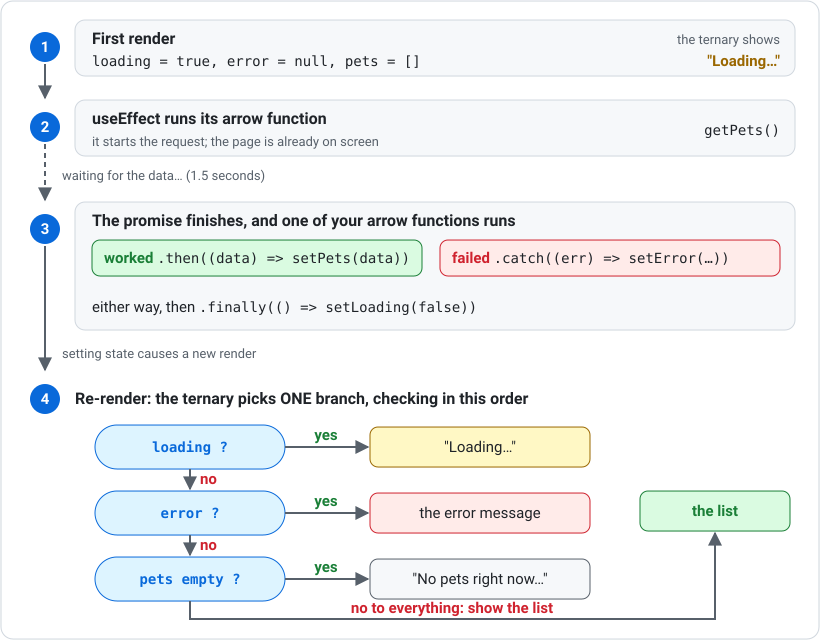

# useState and useEffect

Two of the most important React hooks are `useState` and `useEffect`. Understanding when and how to use each one is essential for building data-driven interfaces.

Both hooks only work in **client components**, so add `"use client"` at the top of any file that uses them (see [Client and Server Components](client-server-components.md)).

---

## useState — Managing Component State

A value you create inside a component is thrown away and rebuilt on every render, and React has no way to notice that it changed — so the screen stays frozen. `useState` fixes both problems: it keeps a value alive between renders, and it tells React to redraw the screen when that value changes. That is what makes counters, forms, search boxes, and fetched lists work.

```tsx
"use client";

import { useState } from "react";

export default function Counter() {
    const [value, setValue] = useState(0);

    return (
        <div>
            <p>Count: {value}</p>
            <button onClick={() => setValue(value + 1)}>Add</button>
        </div>
    );
}
```

- `value` — the current state value
- `setValue` — the function to update it
- `useState(0)` — the `0` inside parentheses is the initial value

---

## useState with Objects and Arrays

State can hold objects:

```tsx
const [user, setUser] = useState({ name: "", email: "" });

setUser({ ...user, name: "Alice" });   // spread keeps existing fields
```

State can hold arrays:

```tsx
const [items, setItems] = useState<string[]>([]);

setItems([...items, "new item"]);       // add to array
```

---

## useEffect — Running Code After Render

A component's job is to return UI, but plenty of work — fetching data, setting timers, reading the browser — does not belong inside the render. Those are *side effects*, and `useEffect` is where they go: it runs code after the screen has been drawn, and its dependency array decides when that code runs again.

```tsx
"use client";

import { useState, useEffect } from "react";

interface Product {
    id: number;
    title: string;
}

export default function Products() {
    const [products, setProducts] = useState<Product[]>([]);

    useEffect(() => {
        fetch("https://dummyjson.com/products")
            .then(res => res.json())
            .then(data => setProducts(data.products));
    }, []);

    return (
        <ul>
            {products.map(p => <li key={p.id}>{p.title}</li>)}
        </ul>
    );
}
```

- The fetch runs automatically when the component first renders
- `setProducts` updates state with the fetched data
- The component re-renders to show the data

Here is what happens, in order:



---

## Dependency Arrays

The second argument to `useEffect` is the dependency array:

```tsx
useEffect(() => {
    console.log("Effect ran");
}, []);             // empty array: runs once on mount
```

```tsx
useEffect(() => {
    console.log("Count changed:", count);
}, [count]);        // runs when `count` changes
```

```tsx
useEffect(() => {
    console.log("Effect ran");
});                 // no array: runs after every render (avoid)
```

---

## Avoiding Repeated Fetch Loops

A common mistake is forgetting the dependency array, which causes an infinite loop:

```tsx
// INCORRECT - infinite loop!
useEffect(() => {
    fetch("/api/data")
        .then(res => res.json())
        .then(data => setData(data));   // setData triggers re-render,
});                                     // re-render triggers useEffect again...
```

The fix is the empty dependency array:

```tsx
// CORRECT - runs once
useEffect(() => {
    fetch("/api/data")
        .then(res => res.json())
        .then(data => setData(data));
}, []);   // empty array = run only once
```

---

## Don't Call Setters Directly in an Effect

If you see the lint error **"Calling setState synchronously within an effect"**, you called something like `setLoading(true)` directly inside `useEffect`. Put starting values in `useState(…)` instead, and only call setters inside `.then()`, `.catch()` or `.finally()`, or after an `await`:

```tsx
// INCORRECT
useEffect(() => {
    setLoading(true);
    fetch(url).then(/* ... */);
}, []);

// CORRECT - loading starts as true
const [loading, setLoading] = useState(true);

useEffect(() => {
    fetch(url)
        .then((res) => res.json())
        .then((data) => setItems(data))
        .finally(() => setLoading(false));
}, []);
```

---

## Why Does My Effect Run Twice?

In development, React runs your effects **twice** when the page first loads, to help catch mistakes. If every `console.log` in your effect shows up twice, that's why. It doesn't happen in the real, built app.

---

## Running an Effect Again

The dependency array lists the values the effect depends on. Whenever one of them changes, the effect runs again:

```tsx
useEffect(() => {
    fetch(`https://jsonplaceholder.typicode.com/todos?userId=${userId}`)
        .then((res) => res.json())
        .then((data) => setTodos(data))
        .finally(() => setLoading(false));
}, [userId]);   // runs again every time userId changes
```

### A reload button

You can use this to build a reload button. Keep a counter in state, put it in the dependency array, and add one to it when the button is clicked:

```tsx
const [reloadKey, setReloadKey] = useState(0);

useEffect(() => {
    // ...fetch here...
}, [reloadKey]);

const reload = () => {
    setLoading(true);
    setError(null);
    setReloadKey((prev) => prev + 1);
};
```

Calling setters inside a click handler is fine. The lint rule above only applies to code directly inside `useEffect`.

---

## The Cleanup Function

The arrow function inside `useEffect` can **return another arrow function**. React runs that one before the effect runs again, and when you leave the page. It's called the **cleanup**.

When the user switches quickly (for example from user 1 to user 2), an old, slow answer can arrive **after** the new one and overwrite it. The cleanup fixes that by telling the old request to ignore its answer:

```tsx
useEffect(() => {
    let ignore = false;

    fetch(`https://jsonplaceholder.typicode.com/todos?userId=${userId}`)
        .then((res) => res.json())
        .then((data: Todo[]) => {
            if (!ignore) setTodos(data);
        })
        .finally(() => {
            if (!ignore) setLoading(false);
        });

    return () => {
        ignore = true;
    };
}, [userId]);
```

Cleanups are also used to stop timers (`clearInterval`) and remove event listeners.

---

## Button Fetch vs Page-Load Fetch

| Button Fetch | Page-Load Fetch (useEffect) |
|---|---|
| User triggers the fetch | Fetch runs automatically |
| Good for search, refresh, submit | Good for loading initial data |
| Uses `onClick` handler | Uses `useEffect` with `[]` |

When to use each:

- **Page-load fetch** — data the user always needs (product list, user profile)
- **Button fetch** — data the user requests on demand (search results, new page of results)

---

## useParams — Reading the URL

`useParams` is another common hook. It reads dynamic values from the URL, and it also requires a client component:

```tsx
"use client";

import { useParams } from "next/navigation";

export default function ProductPage() {
    const params = useParams();
    return <h1>Product {params.id}</h1>;
}
```

`useParams` is covered in more detail on the [Dynamic Routes and useParams](dynamic-routes.md) page.

---

## Summary

- `useState` manages values that change over time
- `useEffect` runs code after render, commonly for fetching data
- Always provide a dependency array to control when effects run
- Empty array `[]` means "run once on mount"
- Use page-load fetch for initial data, button fetch for user-triggered requests
- Only call setters inside `.then()`, `.catch()`, `.finally()` or event handlers, not directly in the effect
- Return a cleanup arrow function to ignore stale responses when dependencies change

### Activity - useEffect and Automatic Fetch

[Attempt Activity - useEffect and Automatic Fetch](../../tasks/useeffect-fetch.md){.md-button}

### Activity - useEffect and Loading States

[Attempt Activity - useEffect and Loading States](../../tasks/useeffect-loading-states.md){.md-button}
