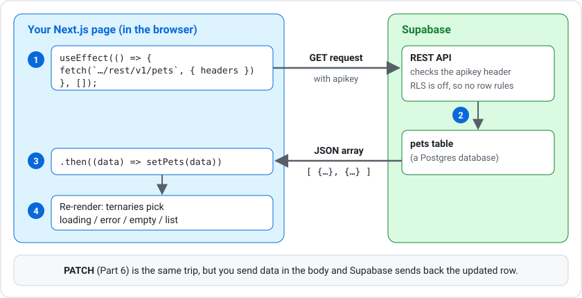

# Supabase REST API with fetch

Every table you create in Supabase automatically gets a **REST API**. This resource shows how to read and change that data from a Next.js app using plain `fetch`, with no Supabase client library.

---

## What is a REST API?

A REST API is a set of URLs that a program can send requests to. The type of request (the **method**) says what you want to do:

| Method | Purpose |
|---|---|
| `GET` | Read data |
| `POST` | Add new data |
| `PATCH` | Change existing data |
| `DELETE` | Remove data |

The answer comes back as JSON, the same format as any other API you fetch from. Supabase's REST API is powered by a tool called **PostgREST**.



***

## Tables, Schemas and Column Types

A **table** is like a spreadsheet: each **row** is one thing and each **column** is one piece of information about it. The **schema** is the plan for the table: which columns it has, and what **type** of data each column holds.

Types matter because the database refuses data of the wrong type. For example, it won't store `"three"` in a number column.

| Supabase type | Holds | TypeScript type |
|---|---|---|
| `int8` / `int4` | Whole numbers | `number` |
| `text` | Text | `string` |
| `bool` | True or false | `boolean` |
| `timestamptz` | A date and time | `string` |

Column names are **case-sensitive**. Keep them lowercase so your code matches.

***

## Keys

Find your keys in the Supabase dashboard by clicking **Connect** at the top of the project, or going to **Project Settings → API Keys**. You need:

- The **Project URL**, e.g. `https://abcdefghijk.supabase.co`
- The **Publishable key**, which starts with `sb_publishable_…` (older projects call this the **anon** key)

### The publishable key

The publishable key is like a visitor pass for your project. Your app sends it with every request so Supabase knows which project the request is for. It is designed to be seen by anyone, because code that runs in the browser can always be read by the person using it.

!!! danger "Never use the secret key in front-end code"
    The **secret** key (`sb_secret_…`, or **service_role** in older projects) skips every security rule and gives full control of your database. Anything in front-end code can be read by anyone who visits your site, so the secret key must never go there.

***

## Row Level Security

Row Level Security (RLS) is a set of rules that decides who can read or change each row of a table. With RLS **on** and no rules written, nobody using the publishable key can see anything.

For practice projects you may turn RLS **off** so you can focus on React. That means **anyone with your publishable key can read and change the table**.

!!! warning
    Turning RLS off is fine for a practice project full of made-up data. **Never** do it with real or private data.

***

## Environment Variables

Keep your URL and key in a file called `.env.local` in the root of your project, next to `package.json` (not inside `app/`):

```bash
NEXT_PUBLIC_SUPABASE_URL=https://abcdefghijk.supabase.co
NEXT_PUBLIC_SUPABASE_PUBLISHABLE_KEY=sb_publishable_xxxxxxxxxxxxxxxx
```

- An environment variable is a setting that lives outside your code
- Next.js only lets browser code see variables whose names start with `NEXT_PUBLIC_`
- **Stop and restart** `npm run dev` after changing `.env.local`; it is only read when the server starts
- `.env.local` is ignored by git by default, so your keys are not pushed to GitHub

### A shared settings file

Create one file that every page imports, so you only write the URL, key, and types once:

```tsx
// app/lib/supabase.ts
export const SUPABASE_URL = process.env.NEXT_PUBLIC_SUPABASE_URL ?? "";

// Every request to Supabase needs the key in an "apikey" header
export const headers = {
    apikey: process.env.NEXT_PUBLIC_SUPABASE_PUBLISHABLE_KEY ?? "",
};
```

`?? ""` means "if the variable is missing, use an empty string instead".

***

## Reading Data

Add the table name to `/rest/v1/` and send the key in the headers:

```tsx
fetch(`${SUPABASE_URL}/rest/v1/products?select=*`, { headers })
    .then((res) => {
        if (!res.ok) throw new Error(`Error ${res.status}`);
        return res.json();
    })
    .then((data: Product[]) => setProducts(data))
    .catch((err: Error) => setError(err.message))
    .finally(() => setLoading(false));
```

This is the same `fetch` pattern you use for any API. Only the URL and the headers change.

### Query parameters

Supabase reads filters and sorting from the URL:

| What | URL (add to `SUPABASE_URL`) |
| --- | --- |
| All rows | `/rest/v1/products?select=*` |
| Sorted by name | `/rest/v1/products?select=*&order=name.asc` |
| Sorted by price, highest first | `/rest/v1/products?select=*&order=price.desc` |
| One row (id 3) | `/rest/v1/products?select=*&id=eq.3` |
| Only some columns | `/rest/v1/products?select=id,name` |

`eq` means "equals". Other filters include `gt` (greater than), `lt` (less than) and `neq` (not equal).

!!! note "Supabase always returns an array"
    Even when you ask for one row by id, the answer is an array. One row comes back as `[ { … } ]`, and a missing row comes back as `[]`. Use `data[0] ?? null` to get the single row, or `null` if it doesn't exist.

***

## Changing Data

To change data, add a `method`, a `Content-Type` header, and a `body`. The `Prefer: return=representation` header asks Supabase to send back the changed row.

### Update a row (PATCH)

```tsx
fetch(`${SUPABASE_URL}/rest/v1/products?id=eq.3`, {
    method: "PATCH",
    headers: {
        ...headers,
        "Content-Type": "application/json",
        Prefer: "return=representation",
    },
    body: JSON.stringify({ inStock: false }),
})
```

- `?id=eq.3` chooses which row to change
- `...headers` copies the `apikey` header in, then the extra headers are added
- `JSON.stringify` turns the object into JSON text for the request body

### Add a row (POST)

```tsx
fetch(`${SUPABASE_URL}/rest/v1/products`, {
    method: "POST",
    headers: {
        ...headers,
        "Content-Type": "application/json",
        Prefer: "return=representation",
    },
    body: JSON.stringify({ name: "Beanie", price: 20 }),
})
```

### Delete a row (DELETE)

```tsx
fetch(`${SUPABASE_URL}/rest/v1/products?id=eq.3`, {
    method: "DELETE",
    headers,
})
```

Changes like these usually happen when the user clicks a button, so put them in an event handler rather than in `useEffect`.

***

## Troubleshooting

| You see | Likely cause |
| --- | --- |
| `Invalid API key` / `No API key found` | `.env.local` is in the wrong place, has a typo, or you didn't restart `npm run dev` |
| `Error 404`, and the Network tab shows a request to `localhost:3000/rest/v1/...` | The env variable isn't being read, so the Supabase URL is empty. Check `.env.local` and restart `npm run dev` |
| `permission denied for table ...` | The publishable key hasn't been given access to the table. Run `grant select, insert, update, delete on table <name> to anon;` in the SQL Editor |
| `relation "public.<name>" does not exist` | The table wasn't created, or it has a different name (check for capitals) |
| `Error 400` | The request was invalid, e.g. `id=eq.abc` when `id` is a number. The Network tab shows Supabase's full message |
| A column is missing or always empty | The column name in Supabase doesn't match your code. Names are case-sensitive |

To see the full details of any request, open DevTools (F12), go to the **Network** tab, and click the request.

***

## Summary

- Supabase creates a REST API for every table at `/rest/v1/<table>`
- Send the publishable key in an `apikey` header; never use the secret key in front-end code
- Store the URL and key in `.env.local` with the `NEXT_PUBLIC_` prefix, and restart the dev server after changes
- Filter and sort with URL parameters such as `id=eq.3` and `order=name.asc`
- Supabase always returns an array, even for one row
- Use `PATCH`, `POST` and `DELETE` with a JSON body to change data

### Activity - Pet Adoption Board

[Attempt Activity - Pet Adoption Board](../../tasks/pet-adoption-board.md){.md-button}

### Activity - Build Your Own Webapp

[Attempt Activity - Build Your Own Webapp](../../tasks/build-your-own-webapp.md){.md-button}
