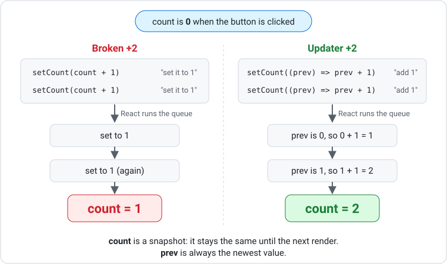

# Arrow Functions, Events and State

These exercises practise inline arrow functions in `onClick` and `onChange`, named arrow-function handlers, `useState` with updater functions, and passing arguments to handlers. You will build the same counter several different ways before moving on to inputs and toggles.

Revisit [Events and State](../resources/nextjs/events-and-state.md) and [Arrow Functions](../resources/nextjs/arrow-functions.md) while you work.

## Setup

!!! abstract "Instructions"
    Create and run a new app called `activity-02`. Press **Enter** to accept every default question.

    ```bash
    npx create-next-app@latest activity-02
    cd activity-02
    npm run dev
    ```

    Paste this line at the bottom of `app/globals.css` so buttons and inputs are visible:

    ```css
    button, input, select { border: 1px solid; padding: 4px 8px; margin: 4px; }
    ```

    Each exercise goes in its own folder (`app/task1/page.tsx`, `app/task2/page.tsx`, …), starting from the starter below. Change `Task1` to match the folder in all three places. Every page uses state, so import `useState` at the top.

??? code "click to expand"
    ```tsx
    "use client";

    import { useState } from "react";

    const Task1 = () => {
        return (
            <main>
                <h1>Task 1</h1>
            </main>
        );
    };

    export default Task1;
    ```

## Counter with Inline Arrows

!!! abstract "Instructions"
    Create `app/task1/page.tsx`.

    1. Make a `count` state starting at `0`.
    2. Show the count in an `<h2>`.
    3. Add three buttons: **+1**, **−1** and **Reset**. Write each `onClick` as an inline arrow function, like `onClick={() => setCount(count + 1)}`.

??? hint "Hint - Click to expand"
    The `useState` line goes inside the component, above the `return`. It gives you two names: the value (`count`) and its setter (`setCount`). Reset is just calling the setter with the starting value.

## Same Counter, Named Handlers

!!! abstract "Instructions"
    Create `app/task2/page.tsx`. Build the same counter again, but this time:

    1. Write each handler as a named arrow function inside the component:

        ```tsx
        const increment = () => {
            setCount(count + 1);
        };
        ```

    2. Pass the function by name: `onClick={increment}`. Leave off the `()`!
    3. Write the `reset` handler with an implicit return.

    **Think:** why is it `onClick={increment}` and not `onClick={increment()}`?

??? question "Hint"
    `onClick` wants a function that React can run **later**. Writing `increment()` runs it **now**, while the page is being drawn, and hands `onClick` whatever it returned. The [Events and State](../resources/nextjs/events-and-state.md) resource has a diagram of this.

## Same Counter, Updater Functions

!!! abstract "Instructions"
    Create `app/task3/page.tsx`. Build the counter a third time, using the **updater function** form of `setCount`.

    An updater function is an arrow function you give to `setCount` instead of a value. React calls it with the newest value (we call it `prev`) and uses whatever it returns as the new value:

    ```tsx
    setCount((prev) => prev + 1);
    ```

    1. Write the **+1**, **−1** and **Reset** buttons using updater functions.
    2. Add a **+2** button whose handler calls `setCount((prev) => prev + 1)` twice.
    3. Add a **broken +2** button whose handler calls `setCount(count + 1)` twice. Click both and compare.

    **Think:** why does only one of them actually add 2?

??? question "Stuck? Open this after you've had a guess"
    `count` is a snapshot that stays the same until the next render, so `setCount(count + 1)` twice sets the same value twice. `prev` is always the latest value, so the updater version builds on the previous update.

    

## Passing Arguments

!!! abstract "Instructions"
    Create `app/task4/page.tsx`.

    1. Write one handler that takes an amount:

        ```tsx
        const addAmount = (amount: number) => {
            setCount((prev) => prev + amount);
        };
        ```

    2. Add buttons **+1**, **+5**, **+10**, **−1**, **−5** and **−10**, all using `addAmount`.
    3. Add a **Double** button and a **Halve** button using updater functions.

??? hint "Hint - Click to expand"
    To pass an argument you can't write `onClick={addAmount(5)}` (that runs immediately). Wrap the call in an arrow function so React has something to run later. Negative amounts work with the same handler.

## Text Input

!!! abstract "Instructions"
    Create `app/task5/page.tsx`.

    1. Make a `name` state starting as `""`.
    2. Add an `<input>` with `value={name}` and an inline arrow `onChange` that copies `e.target.value` into state.
    3. Show `Hello, {name}` below it.
    4. Add a second input for `food`. This time use a **named** handler. Its event parameter is typed `React.ChangeEvent<HTMLInputElement>`.
    5. Show `{name} likes {food}`.
    6. Add a **Clear** button that sets both back to `""`.

??? hint "Hint - Click to expand"
    The inline version is `onChange={(e) => ...}`. Inside, call the setter with `e.target.value`. The named version is the same arrow function moved into a `const`, with a type added to `e`.

## Toggles

!!! abstract "Instructions"
    Create `app/task6/page.tsx`.

    1. Make an `isOn` state starting as `false`.
    2. Show `<p>Light is on: {String(isOn)}</p>`. (Ternaries come in the next set of tasks!)
    3. Add a **Toggle** button using an updater function.
    4. Add **On** and **Off** buttons that set it directly.
    5. Repeat steps 1 to 4 for a second state, `isMuted`, this time with named arrow-function handlers.

??? hint "Hint - Click to expand"
    `!` flips a boolean: `!true` is `false`. A toggle updater takes `prev` and returns the opposite of it.

## From Memory: Score Keeper

!!! abstract "Instructions"
    Without looking, create `app/task7/page.tsx` with a score keeper for two teams.

    - Each team has its own score state
    - Each team has **+1**, **+2** and **+3** buttons that use one shared `addPoints` arrow function
    - One **Reset both** button sets both scores back to zero

??? hint "Hint - Click to expand"
    `addPoints` could take two arguments, e.g. `addPoints("home", 3)`, and use an `if` to decide which setter to call. Or you could write two handlers, `addHome` and `addAway`, that each take an amount.
